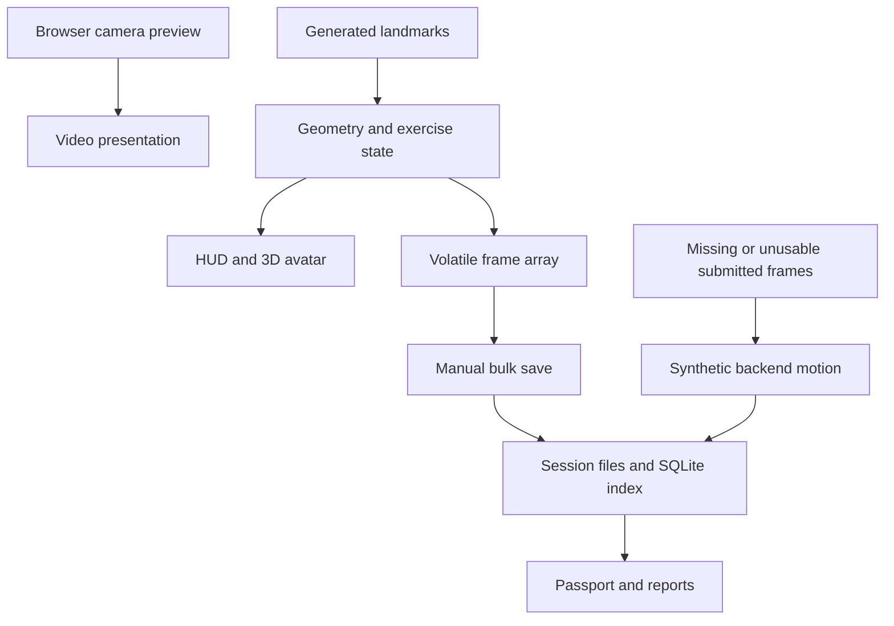

# KineLab PT — Production Test Readiness and Gap Analysis

**Audit date:** 28 October 2026  
**Repository:** [sorensadrgit-art/phnoe-web-app](https://github.com/sorensadrgit-art/phnoe-web-app)  
**Audited revision:** `ffde4be70d0a501980d1d22aac3dea1c91006ff9`, branch `main`  
**Verdict:** **NO-GO for testing as a trustworthy clinical measurement application.** Suitable for continued engineering development and explicitly labelled synthetic demonstrations. Real-participant measurement testing needs the safeguards and controlled validation gates below.

This is a source and software verification audit, not a clinical validation study. It reports what was inspected or executed, distinguishes unverified behavior, and provides an implementable build plan. No application source was changed and no remote code was published.

## 1. Project goal summary

### 1.1 What the project intends to do

The README describes a Windows, local-first PT motion-analysis platform with two modes: a live biofeedback studio and a two-camera research pipeline. It names clinicians and PT use through its terminology, reports and patient fields; research operators also have capture, calibration, synchronization and evidence-review workflows. Patient self-service, clinic administration and multi-user roles are not established implementations. The repository explicitly labels clinical validation unverified. [S01, S04, S09]

| Question | Goal expressed by the inspected code and documentation |
|---|---|
| Who uses it? | A local workstation operator, PT clinician or motion researcher managing one subject's exercise or research recording. The code has patient identifiers but no complete patient/operator identity system. |
| Which live movements? | Squats, lunges, knee extension and single-leg balance are preset options. Their constants are software defaults, not validated prescriptions. |
| Which live measurements? | Knee flexion, torso–thigh angles labelled hip angles, trunk lean, projected knee deviation labelled valgus, and bilateral angular symmetry. The visualization includes shoulders, elbows, wrists and feet, but those points do not establish implemented clinical measurements of every joint. |
| How should live tracking work? | Browser camera selection and preview, landmark-derived geometry, exercise state machine, canvas HUD and a Three.js avatar. **The current measurement loop actually uses generated landmarks, including when a real camera preview is enabled.** |
| How does research capture work? | Two cameras with six source roles: `cam01_intrinsics`, `cam02_intrinsics`, `cam01_board`, `cam02_board`, `cam01_trial` and `cam02_trial`. Phone footage is imported as MP4; a Windows webcam path uses FFmpeg. Direct phone live streaming is not implemented in the inspected frontend. |
| How does research processing work? | Normalize videos, calibrate cameras, estimate 2D pose using Pose2Sim, synchronize, associate the person, triangulate 3D and filter trajectories. Optional marker augmentation and OpenSim IK stages exist in the CLI. Guided UI processing currently ends with marker-only export. |
| What does it output? | Live visual feedback, exercise counts/faults, a set summary, saved session files, JSON/CSV/PDF reports, motion JSON, evidence passports, and a 3D review workspace. Native parsers support TRC/MOT and OpenSim coordinate mappings. Gait/squat research tools produce candidate events and reference comparisons. |
| What muscle measurement exists? | None was found: no EMG acquisition, electrode/channel model or validated muscle-activation output. An animated skeleton or a muscle-bearing OpenSim model is not a muscle-activity measurement. |

Evidence: [S01–S13, S18–S21, S28]; feature-level verification is in section 2.

### 1.2 Differences from your goal

Your goal is a **live body joint and muscle tracker whose data can be trusted without silent failures**. The current product is a combination of a synthetic live studio and an unfinished native research workflow.

The material mismatches are:

1. **A visible camera image does not drive the live measurements.** `generateSimulatedPose` is called unconditionally in the recording loop. The backend also fabricates motion when submitted frames are absent or unusable. Those saved records can be treated as real, reportable sessions. [S04, S09; P01, P09]
2. **The measurement scope is lower-limb oriented, not validated whole-body tracking.** Live metrics cover the limited geometry above; the native reconstruction gate requires seven pelvis/hip/knee/ankle landmarks. Displaying more landmarks does not validate other joint degrees of freedom. [S05, S19]
3. **Muscle activity is absent.** Adding measured muscle activity is a material hardware, synchronization, validation and workflow decision. [S02, S03, S04, S18; section 6]
4. **“Zero latency,” “clinical report,” “100% SHA-256 verification,” and successful-looking evidence states overstate verified capability.** The audit reproduced fabricated reports, restore failures and quality bypasses. The clinical-unverified disclaimers should be retained, but do not repair false measurement or integrity status. [S01, S10, S12, S13; P09–P24]
5. **Offline software distribution is incomplete.** The package builder runs, but omits required native entry files and does not establish a clean-machine, air-gapped installation with runtime, dependencies and model assets. [S27; V13]

### 1.3 What “zero error” can realistically mean

Literal zero pose-estimation error is not an achievable product guarantee. Every camera measurement has a reference definition, calibration, observation conditions and uncertainty. Even goniometry has observer and instrument uncertainty; it is a useful reference for defined static measurements, not an error-free oracle for arbitrary dynamic 3D motion. A published small knee-goniometry comparison illustrates that reliability and agreement depend on the method. [X02]

**Use “zero silent failure and zero acknowledged-data loss within a declared fault model” as the engineering requirement.** Separate it from measured physical accuracy. Do not advertise “zero error” as a clinical accuracy claim.

The following numerical values are **proposed release targets, not measured KineLab results or universal clinical standards**:

| Dimension | Proposed measurable release gate | Qualification |
|---|---|---|
| Data durability | Zero lost, corrupted, duplicated or reassigned **acknowledged** records in the approved process-kill, power interruption, reconnect, disk-full, retry, migration and restore fault matrix. | Acknowledgement follows durable commit. Samples still in volatile memory are explicitly uncommitted. A single disk cannot guarantee survival of disk destruction; independent recovery copies need a separate RPO/RTO decision. |
| Silent invalidity | Every known invalid fixture is rejected or explicitly marked invalid; no invalid sample contributes to valid ROM, repetitions, hold time or a reassuring report. | Finite testing cannot prove that every future estimation error will be detected. Track false-valid rates and their statistical uncertainty on held-out validation data. |
| Joint-angle accuracy | Initial candidate: per approved joint, plane and movement, **MAE ≤3°, absolute bias ≤2°, and 95th-percentile absolute error ≤5°** on valid samples. | Clinical owner approval is required. Report confidence intervals, Bland–Altman limits of agreement, worst-case errors and subgroup results. A pooled average cannot hide failure of a specific endpoint or population. |
| Measurement availability | Initial candidate: at least **95% valid coverage** during the approved, unobstructed protocol; all rejected duration remains visible. | Report accuracy and coverage together so rejecting difficult frames cannot conceal poor usability. Intentionally occluded periods should be rejected, not forced to meet this availability target. |
| Freshness | Explicit stale/lost status within **250 ms** of missing valid observations; invalidity applied by the next processed sample when a rejection is known. | Freeze valid timers/counters immediately. Show age of any retained last-valid value. |
| Live performance | Initial candidate: sensor-to-display **p95 ≤100 ms, p99 ≤200 ms**, with 30 Hz acquisition and at least 20 Hz processing on the supported device profile. | Measure exposure/capture, inference, filtering and rendering; a requestAnimationFrame rate is not this latency. If infeasible, revise supported hardware or intended use explicitly. |
| Reproducibility | Every result resolves to a committed session generation, units, source type, model/software/configuration/calibration hashes and validity mask. | A checksum proves byte identity, not anatomical or clinical accuracy. |
| Recovery | Demonstrated restoration of complete records and audit history to a clean supported machine within approved RTO, with recovery-point age within approved RPO. | Neither number has been selected. A successful ZIP creation is insufficient. |

Camera model visibility scores are not calibrated joint-angle confidence intervals. Google's pose documentation distinguishes normalized image coordinates, estimated world coordinates and landmark visibility; it also notes synchronous web inference can block the UI thread. These details must inform the implementation, but do not validate KineLab's geometry. [X01]

Durability claims also depend on filesystem, operating-system and hardware behavior. SQLite documents those assumptions; browser storage is normally best effort and can be evicted. A browser cache must not be described as equivalent to a verified clinical record store. [X05, X06]

### 1.4 Definition of production test-ready used here

This report assumes a controlled pilot may collect real participants' health-related measurements and expects the application to preserve and label them truthfully. It therefore treats identity, integrity, safety-relevant validity, privacy and supported installation as blockers.

There are two gates:

- **Engineering measurement-study readiness:** durable recording, truthful source/quality labels, safe recovery, controlled hardware/protocol, approved participant/data procedures, and no clinical decisions based on unvalidated results.
- **Clinical pilot readiness:** the above plus successful reference validation for each claimed endpoint, population and condition, approved intended use and appropriate operational oversight.

A validation study cannot be completed before collecting validation data. The first gate permits that controlled collection; the second permits reliance on the measurements within the approved pilot scope. Public deployment or clinical certification is not established by either this audit or a software test pass.

## 2. Current state inventory

### 2.1 Understand Anything availability, scope and method

**Understand Anything was available and was used as the primary codebase-mapping workflow.** The available capability is its ChatGPT/Codex adaptation, with workspace, graph and evidence contracts and a bundled graph-validation tool. It is not evidence that an upstream Tree-sitter service or a separate proprietary scanner ran.

The audit:

- Retrieved the exact GitHub tree and all **134 tracked files outside `examples/`**, verifying every downloaded file against its Git blob SHA-1.
- Inventoried **132 text files** and identified two icon binaries. The **106 files under `examples/`** are the independent Soren portfolio examples explicitly identified in the README, and were excluded from the KineLab product audit.
- Parsed **58 Python files** with Python AST and **30 JS/JSX/CJS/config files** with Babel, then combined structural relationships with inspected architecture and evidence.
- Produced an Understand Anything graph containing **1,025 nodes, 1,442 edges, six layers and six tour steps**, and passed the bundled structural validator.
- Read the product code, dependency/configuration files, tests and documentation, with focused checks of relevant installed Pose2Sim behavior. Definitions/imports were mapped; complete dynamic call-graph correctness is not claimed.

The graph's valid structure does **not** prove that the application works. Runtime and adversarial results are recorded separately below. Generated graph files were analysis artifacts, not changes to the application.

Research Methodology, Superpowers' verification guidance, Software Architect and TypeSafe Toolkit instructions were available and consulted. GitHub supplied the source; Exa and primary-source web research informed measurement and platform guidance. **Soren.mode was not found in the available skill catalogs.** No claim is made that it ran. TypeSafe Toolkit is guidance for typed AI judgments; it is not a substitute for JavaScript/Python type checks, runtime schema validation or measurement validation.

### 2.2 Observed architecture and stack

| Layer | Inspected implementation | Verified boundary |
|---|---|---|
| Browser application | React 19, JavaScript/JSX, Vite 7; Three.js, React Three Fiber and Drei; canvas HUD; ordinary browser camera APIs. | Desktop and cloud builds passed. Rendered application and physical camera operation were not verified. |
| Local server | Python standard-library `ThreadingHTTPServer`; current `t6_launcher → t6_server → t6_service` entry path; loopback bearer authentication. | Launched after creating the required empty projects directory; selected HTTP/auth routes exercised. |
| Domain/workflow | Python capture/session contracts, workflow controller, stage runner, quality checks, gait/squat research analysis, motion export and reports. | Many unit tests and isolated real-module probes executed; no full physical native workflow. |
| Native stack | Pinned Pose2Sim 0.10.49, OpenSim 4.6, OpenCV, NumPy, FFmpeg-related workflows, Caliscope, Tk/PySide-related utilities; platform-specific native launch paths. | Python requirements installed on Linux in a venv inheriting system packages. This is not a clean Windows installation result. |
| Persistence | Per-session filesystem folders/manifests/raw media/exports plus SQLite metadata index and audit table. Live recording is initially a browser-memory array. | Happy-path writes work; atomicity, retry, corruption and restore defects reproduced. |
| Cloud mode | Separate synthetic showcase build selected by deployment mode; camera/patient/backend actions disabled. `viewer/vercel.json` and cloud build configuration exist. | Build and deployment-mode logic checked; no live deployment or hosting/security verification. |
| Packaging | Python builder assembles Windows-labelled ZIP and digest manifest. | Package creation and four package tests passed; required runtime files/assets and clean-machine operation remain incomplete. |

Lockfile installation resolved React/react-dom **19.3.1**, Vite **7.3.7**, Three **0.180.0**, React Three Fiber **9.8.2** and Drei **10.7.9** in this environment. These are observed installed versions, not a claim about latest or independently vulnerability-reviewed releases. [S02, S03, S27; V01–V07]

The critical current live data path is:

There is no camera-to-landmark inference edge in that live path. [S04, S09]

### 2.3 Feature inventory and status

**Status rules:** **Working** means the specifically described behavior was executed successfully. **Partial** means the implementation exists but is incomplete or has a demonstrated/source-identifiable defect. **Present but unverified** means its presence was inspected but functioning behavior was not confirmed. A Working parser or API route does not make the enclosing clinical feature Working.

| Feature | Status | Evidence and practical limit |
|---|---|---|
| Source bundle and dependency manifests | **Working** for acquisition/install checks | 134 blob hashes matched; npm installation and pinned Python installation completed. No fresh Windows proof. V01–V03; S02–S03. |
| Desktop and cloud compilation | **Working** | Both production builds completed; large-chunk warnings remain. V06–V07. |
| Nine-tab workspace | **Present but unverified** | Overview, Live Tracker, Sessions, Capture, Process, 3D Motion, Analysis, Reports, Diagnostics are wired in navigation/render logic. No browser rendering pass. [S07] |
| Loopback server and bearer authentication | **Working** for exercised routes; broader security **Partial** | Root page 200, unauthenticated health 401, authenticated health/sessions/presets 200. Host/origin restrictions, constrained paths, CSP and no-store headers are present. No clinician-level authorization. [S08]; V14. |
| Launcher bootstrap/lifecycle | **Partial** | Fresh launch required an absent `projects` directory. Idle process used 99.5% of one core over two seconds; source waits on an already-set event in a loop. Favicon SVG request returned 404. Shutdown completed. [S24]; V14. |
| Browser camera preview/device selection | **Present but unverified** | `enumerateDevices/getUserMedia` and cleanup are present. Camera permission, device behavior and visual layout were not exercised. [S04] |
| Live physical pose estimation | **Partial** | Camera preview exists, but every measurement-loop iteration calls generated pose data. No live pose-inference integration was found in the inspected frontend/dependencies. [S02, S04]; P01. |
| Synthetic demo | **Partial** | Explicit cloud demo separation exists and builds. The 10-second generator fixture produced zero counts for all four options; the squat generator never reaches its start threshold. Other zero counts, especially balance without finalization, are observations rather than independent defects. This is not a camera benchmark. [S04, S29]; P08. |
| Knee/hip/trunk/valgus/symmetry geometry | **Partial** | Pure tests pass, but aspect-ratio, degenerate-vector and visibility probes produce wrong or falsely valid values. No reference accuracy study. [S05]; P02–P04. |
| Exercise presets and repetition/hold logic | **Partial** | Four presets/state machines exist; missing metrics can complete a valid rep, zero symmetry becomes 100%, ordinary unilateral extension fails the tested sequence, finish can double-count balance, and gaps add unseen hold time. [S06]; P04–P07. |
| Exercise target units and configuration | **Partial** | Shared target initializes to 80, absent from 60/75/90 selector; it overrides balance's declared 30-second default with 80 while the UI labels degrees. Changes reset state without segmenting retained frames. [S04, S06] |
| HUD and three live layouts | **Present but unverified** visually; measurement semantics **Partial** | Full HUD, Split Dual Live and PiP 3D exist. Split mode is one camera preview plus an avatar from generated landmarks, not independent dual-camera measurement. [S04, S14] |
| 3D live avatar/marker conversion | **Partial** | Arbitrary scene scaling and fabricated offsets become exported markers labelled metres; mirror changes stored coordinates. Rendering/physical scale unverified. [S04, S14] |
| Coaching, chimes and form faults | **Partial** | Form-message/chime paths exist; “Perfect form,” “push deeper” and angular asymmetry described as load exceed established evidence. No physical or usability validation. [S06, S14] |
| Live set finish/reset/summary | **Partial** | Finish snapshots without stopping ongoing tracking; reset clears memory; balance units and empty-state reassurance are incorrect. [S04, S14]; P06–P07. |
| Live save and motion export | **Partial** | Happy-path files/index entries generated. No incremental durable capture, strict schema, idempotent commit or atomic finalization. Approximately 3.5 seconds of a representative duplicated 20 Hz payload exceeds the 64 KiB API cap. [S04, S08, S09]; P09–P13. |
| Local session creation/import/listing | **Working** for tested filesystem/contract mechanics; full workflow **Partial** | Source/session unit tests and service probes exercised creation and listings. Missing-data/session-index discrepancies remain. [S15–S16]; V12, P15–P16. |
| Native six-role identity/source contract | **Working** for exercised contract tests | Schema, one-subject/two-camera constraints, six roles, containment, hashes, duplicate keys and timezone-aware metadata are checked. This stronger contract does not protect live ingestion. [S15]; V12. |
| Verified original copies and alternate takes | **Working** for exercised local-fixture tests | Staging, hash/size checks, fsync and no-overwrite publication are implemented; alternate takes preserve originals under defined draft rules. Actual camera imports still need physical verification. [S16–S17]; V12. |
| Windows webcam capture | **Present but unverified** | DirectShow/FFmpeg capture to staging, probe and publication exist. No webcam hardware or supported Windows run. [S17] |
| Checkerboard generation/measurement/readiness | **Partial** | Operator and physical-square records/readiness checks exist. Configuration still uses nominal 20 mm; actual measurement is not propagated as calibrated scale. [S17–S18] |
| Video normalization | **Partial** | Synthetic-media tests exercise 1280×720, 30 fps normalization and mappings. Audio is removed. Multi-file publication is not crash-atomic; physical timestamps/drops/calibration coverage remain unverified. [S18]; V12. |
| Independent synchronization review | **Partial** | Manual source-frame cue evidence and native motion-correlation checks exist, with source binding and drift checks. No implemented audio synchronization algorithm or physical timing result. [S19–S20] |
| Guarded native workflow | **Partial** | Stage planning, locks, input/artifact binding and failure paths exist. Actual native stages are mocked in several tests; Windows interpreter assumptions blocked parts of this audit. [S18, S22]; V12. |
| Calibration quality | **Partial** | Camera structure, finite geometry and RMS thresholds checked; residuals read shared logs without full current-run binding. Held-out scale/accuracy unverified. [S19] |
| 3D reconstruction quality | **Partial** | Support/reprojection/coverage checks exist. Sparse timeline and behind-camera/collapsed-skeleton probes pass falsely. [S19]; P22–P23. |
| Filtering/marker augmentation | **Present but unverified** algorithms; validation **Partial** | Native stages exist, but application quality defaults to success after structural checks; inference/filter uncertainty not retained or validated. [S18] |
| OpenSim IK | **Present but unverified** end to end; integration **Partial** | CLI stage and MOT support exist. Guided workflow exports marker-only; application gates for measured subject/model inputs, scaling fit and IK residuals are absent. [S18, S21–S22] |
| TRC/MOT parsing and motion schemas | **Working** for many exercised parser cases; provenance **Partial** | Tests cover malformed numerics, coordinate conventions, time and units. A direct export accepts incomplete stage evidence as passed. No real demo/Blender/full OpenSim round trip verified here. [S21]; V12, P24. |
| 3D Motion playback and plots | **Present but unverified** rendered | Starts with labelled demo; selected session requires Load active. JSON import, play/pause, 0.25×/0.5×/1×, scrubber, four views and knee/hip/ankle plots are implemented. [S23] |
| Synchronized video/3D review | **Partial** | Logic/verifier tests pass; operator manually selects run/normalization/sync JSON plus two MP4s. Integrated retrieval and actual aligned media playback unverified. [S23]; V04–V05. |
| Gait research candidates/manual comparison | **Partial** | Test-only candidate events and source-bound reference matching exist; no validated cadence/metric stride length. Multi-person exclusion is inconsistent. [S28]; V05, V12. |
| Squat research phases/manual comparison | **Partial** | Side-view/single-person/standing-baseline heuristics exist; comparison emphasizes bottom-frame timing, not every phase boundary. No real-patient accuracy evidence. [S28]; V12. |
| SQLite creation, query and online snapshot | **Working** for exercised mechanics | Seven-table schema and real SQLite backup API exercised. SQLite is an index; live frames are not incrementally journaled into it. [S10, S12]; P14–P21. |
| Index reconciliation and schema evolution | **Partial** | Native stage-list shape is ignored, deleted-source rows persist, foreign keys are off, observed corruption replaces baseline hashes, and only initial schema versioning exists. [S10]; P14–P16. |
| Evidence Passport | **Partial** | Existence of arbitrary motion/MOT output can override missing prerequisite gates; displayed ordered progress is not proof of an append-only verified state machine. Clinical/physical-unverified flags are present. [S10–S11]; P09, P14–P16. |
| Session comparison | **Partial** | Checks kind/test-only status rather than full subject, side, endpoint, protocol, model, calibration and unit compatibility. [S10] |
| PDF/CSV/JSON reports | **Partial** | Real output generation exercised. Corrupt telemetry can be silently ignored, defaults invent identity/validity, empty charts fabricate a reassuring rep, and model provenance says BlazePose without proof. [S13]; P21, P25. |
| Backup archive and SQLite snapshot creation | **Working** for exercised creation; recovery **Partial** | Uses SQLite online backup correctly. Default discovery includes backup directory. Service mutex serializes in-process API mutations, but does not establish a coherent snapshot with asynchronous native workers or other writers. [S12]; P17–P20. |
| Restore | **Partial — unsafe** | Unlisted files accepted, manifest path traversal replaces outside a root, overwrite can delete original before failing, and audit snapshot is not restored. [S12]; P17–P21. |
| Native utility actions | **Present but unverified** end to end | UI actions open the session folder, Capture Station, checkerboard, exact-frame sync reviewer and runbook; lock inspection and shutdown controls are wired. Physical GUI behavior was not verified. [S07, S17, S20, S22, S24] |
| Native orphan-lock recovery | **Working** for exercised guard tests; whole-session recovery **Partial** | PID/ownership checks and archival exist; they do not recover browser frames, durable job state or multi-file partial commits. [S22]; V12. |
| Errors/loading/empty states | **Partial** | Loading, toasts and warnings exist. Some polls/comparisons suppress errors, sidebar ONLINE is fixed, invalid empty summaries can reassure, and startup lacks a comprehensive recoverable boundary. [S07, S14, S25] |
| Session-selection consistency | **Partial** | Uncancelled asynchronous session A requests can update detail after selecting B; source-backed race, not browser-reproduced. Report filters are calculated without rendering the filtered set. [S07, S25] |
| Responsive styling and reduced motion | **Partial** | Breakpoints and CSS reduced-motion rules exist. Inline four-column summary, fixed avatar inset, small labels and JS animation need correction/testing. No screenshot-based claim. [S14, S26] |
| Accessibility | **Partial** | Some labels/buttons exist; modal semantics/focus, toggle state, canvas alternatives, meaningful status announcements and contrast/reflow need validation. [S14, S26] |
| Authentication/privacy | **Partial** | Strong local bearer, loopback and origin restrictions are useful. No complete clinician roles/patient access controls, consent/retention system, protected backup policy or verified no-egress deployment. [S07–S08, S12, S24] |
| Tests and CI/release gates | **Partial** | Seven frontend files plus one omitted test file passed. Broad Python run failed/errored as detailed below. No workflow files in snapshot; main unprotected and audited commit had zero check runs. External CI elsewhere is unknown. [S02, S30]; V04–V12. |
| Windows/offline distribution | **Partial** | Package tests pass after build, but packaging omits `run_pipeline.py` and `launch_sync_review.py`, runtime/model provisioning and fresh setup remain unverified. [S27]; V13. |

### 2.4 Evidence locators

All S references below point to the exact audited commit. Multiple files in a row define the source scope; line ranges are useful starting points rather than a claim of runtime verification. V references identify executed checks in section 3; P references identify boundary probes.

| ID | Inspected source |
|---|---|
| S01 | [README](https://github.com/sorensadrgit-art/phnoe-web-app/blob/ffde4be70d0a501980d1d22aac3dea1c91006ff9/README.md); [physical validation status](https://github.com/sorensadrgit-art/phnoe-web-app/blob/ffde4be70d0a501980d1d22aac3dea1c91006ff9/docs/PHYSICAL_VALIDATION_PENDING.md); [release claims](https://github.com/sorensadrgit-art/phnoe-web-app/blob/ffde4be70d0a501980d1d22aac3dea1c91006ff9/docs/RELEASE_ACCEPTANCE_MATRIX.md) |
| S02 | [frontend manifest](https://github.com/sorensadrgit-art/phnoe-web-app/blob/ffde4be70d0a501980d1d22aac3dea1c91006ff9/viewer/package.json); [frontend lockfile](https://github.com/sorensadrgit-art/phnoe-web-app/blob/ffde4be70d0a501980d1d22aac3dea1c91006ff9/viewer/package-lock.json); [build modes](https://github.com/sorensadrgit-art/phnoe-web-app/blob/ffde4be70d0a501980d1d22aac3dea1c91006ff9/viewer/vite.config.js) |
| S03 | [Python pins](https://github.com/sorensadrgit-art/phnoe-web-app/blob/ffde4be70d0a501980d1d22aac3dea1c91006ff9/requirements.lock.txt); [environment inventory](https://github.com/sorensadrgit-art/phnoe-web-app/blob/ffde4be70d0a501980d1d22aac3dea1c91006ff9/environment.json); [model manifest](https://github.com/sorensadrgit-art/phnoe-web-app/blob/ffde4be70d0a501980d1d22aac3dea1c91006ff9/model-cache.json) |
| S04 | [marker conversion/defaults](https://github.com/sorensadrgit-art/phnoe-web-app/tree/ffde4be70d0a501980d1d22aac3dea1c91006ff9/viewer/src/LiveTrackerStudio.jsx#L56-L153); [camera path](https://github.com/sorensadrgit-art/phnoe-web-app/tree/ffde4be70d0a501980d1d22aac3dea1c91006ff9/viewer/src/LiveTrackerStudio.jsx#L155-L228); [generator, recording and save](https://github.com/sorensadrgit-art/phnoe-web-app/tree/ffde4be70d0a501980d1d22aac3dea1c91006ff9/viewer/src/LiveTrackerStudio.jsx#L245-L414) |
| S05 | [live geometry](https://github.com/sorensadrgit-art/phnoe-web-app/tree/ffde4be70d0a501980d1d22aac3dea1c91006ff9/viewer/src/liveKinematics.js); [geometry tests](https://github.com/sorensadrgit-art/phnoe-web-app/tree/ffde4be70d0a501980d1d22aac3dea1c91006ff9/viewer/src/liveKinematics.test.js) |
| S06 | [presets and state machines](https://github.com/sorensadrgit-art/phnoe-web-app/tree/ffde4be70d0a501980d1d22aac3dea1c91006ff9/viewer/src/exerciseStateMachine.js); [state tests](https://github.com/sorensadrgit-art/phnoe-web-app/tree/ffde4be70d0a501980d1d22aac3dea1c91006ff9/viewer/src/exerciseStateMachine.test.js) |
| S07 | [current application orchestration](https://github.com/sorensadrgit-art/phnoe-web-app/tree/ffde4be70d0a501980d1d22aac3dea1c91006ff9/viewer/src/UnifiedApp.jsx); [navigation, token and passport contracts](https://github.com/sorensadrgit-art/phnoe-web-app/tree/ffde4be70d0a501980d1d22aac3dea1c91006ff9/viewer/src/unifiedModel.js) |
| S08 | [body/auth/static boundaries](https://github.com/sorensadrgit-art/phnoe-web-app/blob/ffde4be70d0a501980d1d22aac3dea1c91006ff9/t6_server.py#L30-L139); [current route implementation](https://github.com/sorensadrgit-art/phnoe-web-app/blob/ffde4be70d0a501980d1d22aac3dea1c91006ff9/t6_server.py) |
| S09 | [live session ingestion and generated fallback](https://github.com/sorensadrgit-art/phnoe-web-app/blob/ffde4be70d0a501980d1d22aac3dea1c91006ff9/t6_service.py#L526-L714) |
| S10 | [index, passport and comparison](https://github.com/sorensadrgit-art/phnoe-web-app/blob/ffde4be70d0a501980d1d22aac3dea1c91006ff9/session_index.py); [existing index tests](https://github.com/sorensadrgit-art/phnoe-web-app/tree/ffde4be70d0a501980d1d22aac3dea1c91006ff9/tests/test_session_index.py) |
| S11 | [passport presentation](https://github.com/sorensadrgit-art/phnoe-web-app/tree/ffde4be70d0a501980d1d22aac3dea1c91006ff9/viewer/src/EvidencePassport.jsx) |
| S12 | [backup/restore implementation](https://github.com/sorensadrgit-art/phnoe-web-app/blob/ffde4be70d0a501980d1d22aac3dea1c91006ff9/backup_manager.py); [backup claims/runbook](https://github.com/sorensadrgit-art/phnoe-web-app/blob/ffde4be70d0a501980d1d22aac3dea1c91006ff9/docs/BACKUP_RESTORE_RUNBOOK.md); [backup tests](https://github.com/sorensadrgit-art/phnoe-web-app/tree/ffde4be70d0a501980d1d22aac3dea1c91006ff9/tests/test_backup_manager.py) |
| S13 | [live report processing](https://github.com/sorensadrgit-art/phnoe-web-app/blob/ffde4be70d0a501980d1d22aac3dea1c91006ff9/report_builder.py#L317-L585); [all report generation](https://github.com/sorensadrgit-art/phnoe-web-app/blob/ffde4be70d0a501980d1d22aac3dea1c91006ff9/report_builder.py) |
| S14 | [HUD](https://github.com/sorensadrgit-art/phnoe-web-app/tree/ffde4be70d0a501980d1d22aac3dea1c91006ff9/viewer/src/LiveHUDOverlay.jsx); [avatar](https://github.com/sorensadrgit-art/phnoe-web-app/tree/ffde4be70d0a501980d1d22aac3dea1c91006ff9/viewer/src/LiveDigitalTwin.jsx); [set summary](https://github.com/sorensadrgit-art/phnoe-web-app/tree/ffde4be70d0a501980d1d22aac3dea1c91006ff9/viewer/src/LiveSetSummaryModal.jsx) |
| S15 | [native session contract](https://github.com/sorensadrgit-art/phnoe-web-app/blob/ffde4be70d0a501980d1d22aac3dea1c91006ff9/session_contract.py) |
| S16 | [session lifecycle/copies](https://github.com/sorensadrgit-art/phnoe-web-app/blob/ffde4be70d0a501980d1d22aac3dea1c91006ff9/session_library.py) |
| S17 | [capture/import/board checks](https://github.com/sorensadrgit-art/phnoe-web-app/blob/ffde4be70d0a501980d1d22aac3dea1c91006ff9/capture_station.py); [native capture UI](https://github.com/sorensadrgit-art/phnoe-web-app/blob/ffde4be70d0a501980d1d22aac3dea1c91006ff9/capture_station_gui.py); [board generation](https://github.com/sorensadrgit-art/phnoe-web-app/blob/ffde4be70d0a501980d1d22aac3dea1c91006ff9/make_board.py) |
| S18 | [native configuration](https://github.com/sorensadrgit-art/phnoe-web-app/blob/ffde4be70d0a501980d1d22aac3dea1c91006ff9/setup_project.py); [normalization](https://github.com/sorensadrgit-art/phnoe-web-app/blob/ffde4be70d0a501980d1d22aac3dea1c91006ff9/normalize_capture.py); [eight native stages and validation](https://github.com/sorensadrgit-art/phnoe-web-app/blob/ffde4be70d0a501980d1d22aac3dea1c91006ff9/run_pipeline.py) |
| S19 | [calibration/sync/reconstruction quality](https://github.com/sorensadrgit-art/phnoe-web-app/blob/ffde4be70d0a501980d1d22aac3dea1c91006ff9/pipeline_quality.py) |
| S20 | [manual sync evidence](https://github.com/sorensadrgit-art/phnoe-web-app/blob/ffde4be70d0a501980d1d22aac3dea1c91006ff9/sync_evidence.py); [frame review UI](https://github.com/sorensadrgit-art/phnoe-web-app/blob/ffde4be70d0a501980d1d22aac3dea1c91006ff9/sync_review_gui.py) |
| S21 | [motion parsing/export](https://github.com/sorensadrgit-art/phnoe-web-app/blob/ffde4be70d0a501980d1d22aac3dea1c91006ff9/export_motion.py); [Blender bridge](https://github.com/sorensadrgit-art/phnoe-web-app/blob/ffde4be70d0a501980d1d22aac3dea1c91006ff9/blender_import.py) |
| S22 | [guarded workflow](https://github.com/sorensadrgit-art/phnoe-web-app/blob/ffde4be70d0a501980d1d22aac3dea1c91006ff9/workflow_controller.py); [lock recovery](https://github.com/sorensadrgit-art/phnoe-web-app/blob/ffde4be70d0a501980d1d22aac3dea1c91006ff9/workflow_recovery.py) |
| S23 | [3D review](https://github.com/sorensadrgit-art/phnoe-web-app/tree/ffde4be70d0a501980d1d22aac3dea1c91006ff9/viewer/src/MotionApp.jsx); [synchronized file review](https://github.com/sorensadrgit-art/phnoe-web-app/tree/ffde4be70d0a501980d1d22aac3dea1c91006ff9/viewer/src/VerifiedReview.jsx); [motion validation](https://github.com/sorensadrgit-art/phnoe-web-app/tree/ffde4be70d0a501980d1d22aac3dea1c91006ff9/viewer/src/motionData.js); [playback mapping](https://github.com/sorensadrgit-art/phnoe-web-app/tree/ffde4be70d0a501980d1d22aac3dea1c91006ff9/viewer/src/syncPlayback.js) |
| S24 | [current startup/lifecycle](https://github.com/sorensadrgit-art/phnoe-web-app/blob/ffde4be70d0a501980d1d22aac3dea1c91006ff9/t6_launcher.py#L125-L231); [retained legacy launcher](https://github.com/sorensadrgit-art/phnoe-web-app/blob/ffde4be70d0a501980d1d22aac3dea1c91006ff9/launch_kinelab_unified.py); [legacy API](https://github.com/sorensadrgit-art/phnoe-web-app/blob/ffde4be70d0a501980d1d22aac3dea1c91006ff9/unified_service.py) |
| S25 | [reports, filters and restore UI](https://github.com/sorensadrgit-art/phnoe-web-app/tree/ffde4be70d0a501980d1d22aac3dea1c91006ff9/viewer/src/ReportStudio.jsx); [capture checklist](https://github.com/sorensadrgit-art/phnoe-web-app/tree/ffde4be70d0a501980d1d22aac3dea1c91006ff9/viewer/src/GuidedCaptureWizard.jsx) |
| S26 | [workspace CSS](https://github.com/sorensadrgit-art/phnoe-web-app/tree/ffde4be70d0a501980d1d22aac3dea1c91006ff9/viewer/src/unified.css); [cloud demo CSS](https://github.com/sorensadrgit-art/phnoe-web-app/tree/ffde4be70d0a501980d1d22aac3dea1c91006ff9/viewer/src/cloudDemo.css); [viewer CSS](https://github.com/sorensadrgit-art/phnoe-web-app/tree/ffde4be70d0a501980d1d22aac3dea1c91006ff9/viewer/src/styles.css) |
| S27 | [package builder](https://github.com/sorensadrgit-art/phnoe-web-app/blob/ffde4be70d0a501980d1d22aac3dea1c91006ff9/tools/build_offline_distribution.py); [distribution documentation](https://github.com/sorensadrgit-art/phnoe-web-app/blob/ffde4be70d0a501980d1d22aac3dea1c91006ff9/docs/CLEAN_INSTALL_REPORT.md) |
| S28 | [gait candidates](https://github.com/sorensadrgit-art/phnoe-web-app/blob/ffde4be70d0a501980d1d22aac3dea1c91006ff9/gait_events.py); [squat candidates](https://github.com/sorensadrgit-art/phnoe-web-app/blob/ffde4be70d0a501980d1d22aac3dea1c91006ff9/squat_events.py); [gait UI logic](https://github.com/sorensadrgit-art/phnoe-web-app/tree/ffde4be70d0a501980d1d22aac3dea1c91006ff9/viewer/src/gaitReviewLogic.cjs) |
| S29 | [cloud synthetic demo](https://github.com/sorensadrgit-art/phnoe-web-app/tree/ffde4be70d0a501980d1d22aac3dea1c91006ff9/viewer/src/CloudDemoApp.jsx); [deployment mode](https://github.com/sorensadrgit-art/phnoe-web-app/tree/ffde4be70d0a501980d1d22aac3dea1c91006ff9/viewer/src/deploymentMode.js); [hosting config](https://github.com/sorensadrgit-art/phnoe-web-app/blob/ffde4be70d0a501980d1d22aac3dea1c91006ff9/viewer/vercel.json) |
| S30 | [Python test directory](https://github.com/sorensadrgit-art/phnoe-web-app/tree/ffde4be70d0a501980d1d22aac3dea1c91006ff9/tests); [frontend sources/tests](https://github.com/sorensadrgit-art/phnoe-web-app/tree/ffde4be70d0a501980d1d22aac3dea1c91006ff9/viewer/src); [historical build assertions](https://github.com/sorensadrgit-art/phnoe-web-app/blob/ffde4be70d0a501980d1d22aac3dea1c91006ff9/docs/FINAL_BUILD_REPORT.md) |

The installed Pose2Sim 0.10.49 demo configuration was also inspected: the application inherits auto-height/default-height, body-mass and bilateral-symmetry defaults unless overridden. These are **dependency observations**, not newly discovered committed patient measurements. Native filtering behavior was inspected sufficiently to avoid the false claim that every filtering method fills every gap; the actual missing capability is application-level filter/augmentation quality and provenance enforcement.

## 3. Verification results

### 3.1 Environment and interpretation

Execution host: **Linux, Python 3.12.14, Node 24.22.1, npm 11.9.0**. The product's documented target is Windows 10/11. The audit venv, `/tmp/kinelab-audit-venv`, was created with `--system-site-packages` and then the pinned requirements were installed. Results therefore establish what ran here, not clean target-platform reproducibility.

In commands below, `ROOT` means the materialized audited repository and `AUDIT` means its sibling audit workspace. The shorthand `.../python` means `/tmp/kinelab-audit-venv/bin/python`. Commands involving audit scripts used temporary fixtures and imported the actual unmodified application modules. No real patient records or cameras were used.

**PASS** is scoped to the command/assertions executed. **FAIL** means a check did not pass. **PARTIAL** means it could not establish the requested end-to-end behavior.

| ID | Command/check and working directory | Outcome | Observed result |
|---|---|---|---|
| V01 | Commit-pinned GitHub retrieval; verify `sha1("blob " + byte_length + NUL + bytes)` for every acquired source file | **PASS** | 134/134 tracked non-example files matched their tree blob hashes; a final recheck after all verification also found zero source changes. |
| V02 | `npm ci --no-audit --no-fund`, `ROOT/viewer` | **PASS** | 128 packages installed. This command deliberately did not run a vulnerability audit. |
| V03 | `/tmp/kinelab-audit-venv/bin/python -m pip install --disable-pip-version-check --no-input --timeout 15 --retries 0 -r requirements.lock.txt`, `ROOT` | **PASS**, scoped | Installation exit 0. Inherited system packages and Linux runtime limit reproducibility claims. |
| V04 | `npm test`, `ROOT/viewer` | **PASS** | Seven Node file-level subtests passed. Tests contain manual assertions; this is not independently confirmed as 43 runner-counted tests. |
| V05 | `node --test src/gaitReviewLogic.test.cjs`, `ROOT/viewer` | **PASS** | One additional test file passed; it is omitted from `npm test`. |
| V06 | `npm run build`, `ROOT/viewer` | **PASS** | Vite build 5.39 s. Main chunk about 938.58 kB / 256.66 kB gzip; warning over 500 kB. |
| V07 | `npm run build:cloud -- --outDir /workspace/scratch/7ca033798da8/audit-cloud-dist`, `ROOT/viewer` | **PASS** | Separate cloud build 4.90 s; about 943.01 kB / 257.98 kB gzip main chunk. No deployment executed. |
| V08 | `npm run lint`, `ROOT/viewer` | **FAIL** | Missing script. No configured frontend lint gate was run successfully. |
| V09 | `npm run typecheck`, `ROOT/viewer` | **FAIL** | Missing script. JSX compilation is not a substitute for type checking or runtime validation. |
| V10 | Python AST parse of all 58 tracked `*.py` files | **PASS**, syntax only | No parse errors. Not a Python type check. |
| V11 | Initial `python3 -B -m unittest discover -s tests -v`; then pinned venv run under restricted sockets | **FAIL / environment-limited** | Initial: 119 run, 3 failures, 18 errors, 3 skips. Pinned restricted run: 223 run, 5 failures, 49 errors, 3 skips. Missing dependencies/assets and blocked sockets affected these attempts; the allowed-socket run below is the relevant broad result. |
| V12 | `/tmp/kinelab-audit-venv/bin/python -B -m unittest discover -s tests -v`, `ROOT`, with local sockets permitted | **FAIL** | **223 run: 201 passed, 6 assertion failures, 13 errors, 3 skips**, exit 1, 30.741 s test runtime. Not a green full suite. |
| V13 | `/tmp/kinelab-audit-venv/bin/python tools/build_offline_distribution.py`; then `.../python -B -m unittest discover -s tests -p test_offline_distribution.py -v` | **PASS** for packaging tests; deployment **PARTIAL** | Builder produced 52 files and ZIP; all four targeted package tests passed after generation. Full suite was not rerun after this prerequisite was added. |
| V14 | `/tmp/kinelab-audit-venv/bin/python t6_launcher.py --no-browser`; authenticated/unauthenticated HTTP probes; process CPU measurement; SIGINT shutdown | **PARTIAL** overall | Initial launch failed `SESSION_ROOT_MISSING`. After creating an empty runtime `projects` directory, root/API checks passed; favicon 404; measured idle CPU 99.5% over two seconds. No fabricated demo project was supplied. |
| V15 | Connected Browser plugin, then permitted cloud-browser fallback to running local URL | **PARTIAL** | Plugin required originating extension context; cloud browser's localhost could not reach execution-host localhost (`ERR_CONNECTION_REFUSED`). No screenshot, mounted UI, keyboard, camera or visual pass is claimed. |
| V16 | `node AUDIT/audit-notes/tracking-probes.mjs` | **FAIL** for targeted product invariants | Script completed; deterministic geometry, lifecycle, no-data and request-size counterexamples below. |
| V17 | `.../python AUDIT/audit-notes/probe_backup_isolated.py` and `.../python AUDIT/audit-notes/probe_data_integrity.py` | **FAIL** for targeted product invariants | Actual production imports; five backup and nine service/index/backup probes reproduced defects. Filename “isolated” does not mean the successful execution used mocked production modules. |
| V18 | `.../python -B AUDIT/audit-notes/pipeline_probes.py` | **FAIL** for safety invariants; one validation check **PASS** | Sparse/impossible geometry, incomplete export and corrupt-report probes reproduced failures. Raw confidence 1.05 was rejected under the existing [0,1] rule; compatibility with native model-score semantics remains unverified. |
| V19 | `python3 AUDIT/audit-tools/graph_tool.py validate ROOT/.ua/knowledge-graph.candidate.json` | **PASS**, structural only | `ok:true`, 1,025 nodes and 1,442 edges. Candidate then published as the audit graph. |
| V20 | GitHub repository/branch metadata and commit check-runs queries | **PARTIAL** for CI readiness | Main reported unprotected; audited commit returned zero check runs; complete tree had no `.github` workflow files. External CI outside this repository is unknown. |

The fresh broad-suite failures/errors included absent ignored demo TRC footage, a workstation-specific OpenSim model path, missing project Windows interpreter, no graphical display for Tk, native workflow expectations and distribution artifacts not yet built. These are not all proven application logic regressions. They do establish that the claimed release cannot currently be reproduced by this run.

Two distribution assertions and one distribution error from V12 were resolved by building the package and rerunning its four tests in V13. **That targeted result does not turn V12 into a pass.** Three skips concern unavailable real demo media/Blender execution. Historical README “266 passed” badges were not accepted as fresh verification.

### 3.2 Reproduced boundary failures

These are deterministic software fixtures, not measurements of real movement. “Script exit 0” means a probe completed and recorded the counterexample.

| ID | Input or action | Actual observation |
|---|---|---|
| P01 | Trace the live camera/recording loop | The loop calls `generateSimulatedPose` regardless of camera-preview mode. No inference result feeds recorded frames. Source-confirmed, not a physical camera experiment. |
| P02 | Same geometry expressed in equal units versus separately normalized 16:9 x/y | Angle changes from **135° to 119.4°**. Coincident points yield **180° knee flexion**. |
| P03 | Landmarks with zero visibility | Metrics still produce numeric values and **100% symmetry** rather than invalid measurement. |
| P04 | Supply missing metrics after a partial movement | State completes **one valid rep**, with “Perfect form” coaching. |
| P05 | A rep whose true minimum symmetry is zero | Reported average symmetry becomes **100%** due to a falsy default. |
| P06 | Seated unilateral-extension fixture; repeat balance finalization | Extension remains IDLE with zero reps; repeated balance finish changes count from one to two. |
| P07 | Balance observations separated by an unobserved interval | Unseen elapsed time contributes to the displayed hold. |
| P08 | 600 generated updates for each exercise at modeled 60 Hz | The roughly 10-second fixture, without finishSet(), yields zero counts for all four. Generated squat flexion is only 9.2–17.6°, below its start threshold; other zero counts do not independently establish a defect, especially for the longer balance hold. |
| P09 | Save one-rep live payload with no frame sequence | Save succeeds, generates 60 frames, names a nonexistent TRC and receives `RESEARCH_REPORTABLE` with `is_test_only:false`. |
| P10 | Retry identical explicit session ID/payload | Rejected as existing folder instead of returning the prior durable receipt. |
| P11 | Unsupported exercise, negative FPS/time, malformed frame data, NaN and string `"false"` as validity | Accepted and persisted; string is counted truthy/valid, NaN reaches stored JSON. |
| P12 | Inject failure while writing telemetry after session metadata | Session remains discoverable as **completed**, with no telemetry or motion export. |
| P13 | Encode actual duplicated client payload shape | 69 fixture frames: 65,530 bytes; 70: **66,492 bytes**, above 65,536-byte limit. At nominal 20 Hz that is about **3.5 seconds**. This is calculated payload size, not measured throughput; metadata/value lengths can change the boundary. |
| P14 | Corrupt saved motion, then reindex | Expected hash baseline is replaced; altered object is served and remains reportable. |
| P15 | Index actual native stage-list format | Producer writes a list; reader expects a dict, swallows failure, indexes **zero runs**. |
| P16 | Delete a source file; create arbitrary invalid motion output | Stale captured row survives; foreign-key enforcement is false. An invalid `*.motion.json` still promotes passport state. |
| P17 | Restore archive containing an unlisted file | Unchecked file is published despite not appearing in the hash manifest. |
| P18 | Restore manifest session `../outside-projects` with overwrite in a disposable parent | Sibling fixture outside the project root is replaced. This is a demonstrated manifest-path bug, not an assumed generic ZIP extraction vulnerability. |
| P19 | Overwrite restore with absent staged session source | Existing session is deleted, then `FileNotFoundError` occurs. |
| P20 | Default service-style backup location; symlinked source | Backup directory is itself selected as a session and generated archive fails restore; a file symlink also causes outside-source bytes to be archived. |
| P21 | Restore real SQLite snapshot with one audit event; separately corrupt report telemetry | Restored sessions reindex but audit count becomes **zero**. A corrupt-telemetry report still succeeds with three summary reps and zero detail rows. |
| P22 | Reconstruction observations only at frames 0 and 1000 | Quality returns **100% coverage** and **zero-frame longest gap** because absent frame positions are not represented. |
| P23 | All seven required markers coincide behind both cameras, with matching projections | Full validator returns `ok:true` and **0 px reprojection error** despite impossible geometry. |
| P24 | Direct export with only calibration/filtering stages and no quality evidence | Produces motion v2 with `quality.status:"passed"`. The stricter GUI controller does not fix this CLI/export bypass. |
| P25 | Corrupt live telemetry through real report generation | Actual PDF/JSON created; chart invents rep 1 at 0° and 100% symmetry and says “Clean execution.” |

### 3.3 What remains unverified

No real participant, goniometer, EMG device, camera-reference study, supported Windows installation, physical synchronization experiment, complete native OpenSim workflow, hardware power-loss test, backup disaster drill, deployed cloud environment or visual browser audit was performed.

No clinical joint-angle error, muscle accuracy, physical latency or safe exercise-prescription conclusion can be inferred from these tests. Source-based UI concerns are labelled as such; browser reachability failure was an environment limitation.

## 4. Complete list of required additions

### 4.1 Priority and implementation order

**Blocker for production test** means the application cannot be trusted with the corresponding human-measurement workflow until resolved. Native-only and muscle-only blockers are conditional on including those features; otherwise disable that path and remove its claims from the release. A conditional item is not permission to display unverified output as valid.

**Required** means necessary for the supported production test release to be complete and operable. **Recommended** improves maintainability, diagnosis or future scope after the safety and integrity gates.

Implement in this order:

1. **Make evidence truthful:** disable the false live-measurement path, reject synthetic fallback in real sessions, remove false passed/clean statuses, and freeze a shared measurement contract.
2. **Make records durable:** incremental recording, atomic publication, idempotent retries, stable identity, immutable integrity verification, protected data root, recoverable migrations and safe restore.
3. **Build the chosen measurement pipeline:** genuine camera inference or sensor acquisition, calibrated geometry, temporal/quality logic, exercise semantics and hardware support.
4. **Prove it under failure and against reference:** destructive tests on disposable data, clean supported-machine installation, complete workflow integration, latency/load tests and controlled physical validation.
5. **Complete clinical workflows and usability:** setup/calibration, review/history/export, accessible uncertainty and storage feedback, operations documentation and pilot support.

Assign each requirement an owner, linked change and evidence artifact. A status badge may only change after the stated acceptance criterion is met.

### 4.2 Blockers for production test

| ID / addition | Reason and affected implementation | Testable acceptance criterion |
|---|---|---|
| **B01 — Real acquisition and permanent source provenance** | Live and backend paths fabricate motion. A camera preview must not imply measurement. **Files:** `LiveTrackerStudio.jsx`, `liveKinematics.js`, `t6_service.py`, report/export consumers; **new:** versioned pose/sensor adapter. [S04, S09; P01, P09] | A known prerecorded moving-body sequence produces time-aligned landmarks from the selected pinned model; covering/removing the subject changes validity and never falls back to animation. Source kind `camera/EMG/import/synthetic` is immutable and visible in every downstream output. Missing measured frames reject or produce an explicitly incomplete record. Synthetic data cannot enter a real-session namespace. Referenced TRC/model assets must exist and match hashes. |
| **B02 — One strict runtime measurement contract** | Live API accepts unsupported exercises, malformed vectors, NaN, negative timing and truthy string booleans. **Files:** `t6_server.py`, `t6_service.py`, `session_contract.py`, frontend serializers, all report/export readers; **new:** shared versioned schemas. [S08–S09; P11] | Reject duplicate JSON keys, nonfinite numbers, wrong types/dimensions, unsupported IDs/versions, invalid units, negative/nonmonotonic timestamps, duplicate sequence numbers and inconsistent summaries **before publication**. Error identifies field/reason and preserves recoverable draft. Native producer/consumer and live code round-trip identical typed fixtures. Standard JSON serialization forbids NaN. Unknown future schemas fail clearly. |
| **B03 — Incremental durable session recording** | Current data lives in a component ref until a bulk save that soon exceeds API size limits. **Files:** `LiveTrackerStudio.jsx`, `t6_server.py`, `t6_service.py`, `session_index.py`; **new:** recorder journal/chunk API. [S04, S08–S10; P13] | Persist bounded chunks continuously with stable session/set/chunk IDs and sequence ranges. UI receives a durable acknowledgement only after commit; a saved-through indicator covers only a contiguous prefix. Deliver chunks 1, 3, then 2: the prefix stays at 1 until 2 commits. At agreed maximum duration/rate, memory and queue sizes remain bounded and data exceeds 64 KiB without failure. Kill renderer/service at every tested boundary: all acknowledged chunks recover exactly; unacknowledged tails and sequence gaps are explicit. A larger bulk-request limit alone does not satisfy this. |
| **B04 — Atomic finalization and multi-file publication** | Session is labelled completed before telemetry/exports; native normalization publishes several files separately. **Files:** `t6_service.py`, `normalize_capture.py`, `capture_station.py`, `setup_project.py`, export/report writers. [S09, S17–S18; P12] | Use a durable transaction/generation journal and commit manifest. At every write/flush/rename/index boundary, exception, process-kill, disk-full and supported power-loss tests recover either the previous committed generation or the complete new one. Mixed/incomplete generations never show completed. Preserve originals and quarantine partial artifacts. Readers use committed generations only. |
| **B05 — Idempotency, concurrency and one authoritative writer** | Retries fail ambiguously; second-resolution IDs can collide; locks are process-local and launcher startup has a source-level race. **Files:** `t6_service.py`, `t6_launcher.py`, `session_index.py`, live client. [S09, S24; P10] | Client generates stable IDs before capture. Repeating an identical request after lost response returns the same receipt; same idempotency request/chunk key with different payload rejects as conflict. Concurrent chunk/session submissions produce exactly one committed result. Simultaneous launches yield one writer or explicit refusal. Mutations use transactions and revision checks; tests cover overlapping finalize/retry/backup/reindex. |
| **B06 — Immutable evidence and fail-closed prerequisite gates** | Reindex blesses changed bytes; file existence and incomplete manifests can imply passed outputs. **Files:** `session_index.py`, `run_pipeline.py`, `workflow_controller.py`, `export_motion.py`, `t6_service.motion_data`, passport/reports. [S10, S18, S21–S22; P14–P16, P24] | Preserve committed expected hashes and protect audit history against unauthorized modification; authorized changes create new revisions. Changed/missing upstream bytes invalidate dependent results and raise visible audit events; reindex cannot replace the baseline. API, CLI, GUI, resume and export share the same ordered prerequisite validator. Omitted/failed/reordered stages, arbitrary output files and stale quality evidence cannot yield passed/reportable. Explicit exploratory exports remain unverified and segregated. |
| **B07 — Correct index, schema migrations and durable audit history** | Run schema mismatch, stale rows, disabled FK enforcement and audit loss undermine provenance. **Files:** `session_index.py`, `backup_manager.py`, all mutating service actions; **new:** migration fixtures/audit schema. [S10, S12; P15–P16, P21] | Native stage lists index correctly. Reconciliation identifies absent/corrupt records rather than retaining valid state. Enforce relied-on foreign keys; transactional migrations have interruption/rollback and future-version rejection tests. Record actor, action, revision, inputs, outcome and timestamp for capture, edits, export, reports, deletion, restore, recovery and access-policy changes. Rebuild/restore preserves audit event identities; an index rebuild cannot substitute for lost audit evidence. |
| **B08 — Safe restore validation and containment** | Demonstrated unchecked content, outside-root replacement and destructive overwrite failure. **Files:** `backup_manager.py`, backup API/tests, restore UI. [S12; P17–P20] | Before touching live data, validate schema, session IDs, exact archive inventory, normalized contained paths, uniqueness, sizes and hashes; reject traversal/absolute paths, symlinks and resource-limit violations. Missing/unlisted/duplicate entries fail. Extract only to bounded staging. All demonstrated malicious/incomplete fixtures reject with **zero changes** to destination or sibling directories. |
| **B09 — Coherent backup and rollback-capable recovery** | Backup includes its own directory; DB snapshot/audit is not restored. In-process API writes are serialized, but asynchronous native workers/other writers are not bound to one snapshot generation. **Files:** `backup_manager.py`, `session_index.py`, service, `ReportStudio.jsx`, runbook. [S12; P20–P21] | Exclude backup/staging trees. Snapshot one committed generation including audit history and verify after creation. Preview conflicts and chosen resolution; create a safety recovery point before cutover. Inject failure at every cutover: originals remain or roll back. A clean-machine restore reproduces identities, counts, source digests, revisions and audit events. Demonstrate an independent-copy recovery drill against approved RPO/RTO. |
| **B10 — Subject/operator identity and asynchronous UI isolation** | Generic patient default and late responses can misattribute or display another session's evidence. **Files:** `LiveSetSummaryModal.jsx`, `LiveTrackerStudio.jsx`, `UnifiedApp.jsx`, `ReportStudio.jsx`, schemas/reports/audit. [S07, S09, S13–S14] | Human capture requires explicit pseudonymous subject/operator and laterality/protocol confirmation, locked to the set. No silent default patient. Corrections create audited revisions. Delayed A responses after selecting B cannot change B's detail, passport, report or export target. Abort/version requests and check returned identity; automated mounted-UI tests prove rapid-switch/poll/reconnect safety. |
| **B11 — Valid geometry, confidence and occlusion rejection** | Aspect ratio, zero-length limbs, missing visibility and image-to-metre conversion are invalid. **Files:** `liveKinematics.js`, pose adapter, `LiveTrackerStudio.jsx`, HUD/export. [S04–S05; P02–P04] | Define image/pixel/metric coordinate spaces, camera crop, mirror and left/right conventions. Correct aspect handling; reject degenerate/nonfinite/out-of-plane/ambiguous-person/occluded/stale observations. Image-normalized coordinates cannot be labelled measured metres. Nondegenerate pixel-coordinate fixture angles match analytical references within 0.1° and retain the same result across equivalent aspect/crop/mirror representations with correct anatomical side; all known invalid fixtures produce invalidity, not zero/180°/100% defaults. Calibrate thresholds against reference error and preserve per-joint reasons/uncertainty. |
| **B12 — Correct exercise semantics and immutable set lifecycle** | Missing data counts as a rep; extension/balance/zero values/finish/configuration have reproducible defects. **Files:** `exerciseStateMachine.js`, `LiveTrackerStudio.jsx`, `LiveSetSummaryModal.jsx`. [S04, S06, S14; P04–P08] | Each exercise has validated active side, units, phase/direction and timing rules. Seated extension fixture counts correctly; missing data cannot complete reps; gaps/pause add no valid hold time; zero remains zero. Finish stops acquisition and is idempotent. Target/exercise changes create a new versioned set or are locked during capture. Displayed/effective targets match, balance uses seconds, and reset cannot erase unacknowledged recoverable work silently. |
| **B13 — Run-bound calibration and synchronization** **if native research is supported** | Shared logs can supply stale residuals; board dimensions/lens conventions are inconsistent. **Files:** `pipeline_quality.py`, `sync_evidence.py`, `setup_project.py`, normalization/capture adapters. [S17–S20] | Structured measurements bind run/config/model/calibration/raw/normalized/mapping hashes, camera order, units and actual board dimensions/uncertainty. Old log entries cannot pass a new run. Calibration invalidates after incompatible geometry changes. Nonzero-distortion fixtures and held-out physical checks validate scale/reprojection. Known positive/negative offsets and interval boundaries match actual synchronized content; drift beyond approved budget rejects or invokes a validated recorded correction. |
| **B14 — Complete timelines and physically possible 3D** **if native research is supported** | Sparse frames and behind-camera coincident skeleton pass. **Files:** `pipeline_quality.py`, `export_motion.py`, stage manifests, normalization maps. [S19, S21; P22–P23] | Use expected source interval/grid, including missing and duplicate frames. Account separately for observed/rejected/dropped/trimmed/interpolated samples. Frames 0 and 1000 cannot mean uninterrupted coverage. Reject negative camera depth, collapsed limbs and inadequately conditioned triangulation; enforce documented anatomical/temporal checks. Preserve source frame IDs and gap masks through filtering/export. Reprojection alone never establishes clinical accuracy. |
| **B15 — Model fitting, filtering and IK validity** **if claimed** | Several native stages receive unconditional quality success; inherited body defaults are not measured patient inputs. **Files:** `run_pipeline.py`, `setup_project.py`, `export_motion.py`, processing UI. [S18, S21–S22] | Select/record approved subject parameters, model hash, scaling setup and constraints. Missing inputs or fallback height/mass remain explicit and block unsupported clinical claims. Preserve observed versus inferred markers. Validate filter peak/timing distortion and IK/scaling residuals against approved thresholds. Retain exact setup/output evidence. Either complete the guided IK flow and physical tests or ship clearly labelled marker-only output. |
| **B16 — Truthful, reproducible reports and exports** | Corrupt/no evidence becomes clinical-looking success; invented identity/model/rep values and mismatched totals exist. **Files:** `report_builder.py`, `export_motion.py`, `ReportStudio.jsx`, motion/report API. [S13, S21, S25; P21, P25] | Malformed evidence blocks a valid report with an actionable integrity error. No-data output says “No valid measurements”; no clean-form, fake rep, default symmetry or unsupported model claim. Tables/charts/totals reconcile to the same immutable generation and include all reps or explicit pagination. Each revision records actual source/model/calibration/units/gaps/software; reruns create a new linked revision, not silent overwrite. |
| **B17 — Reference validation for every clinical measurement claim** | No measured accuracy result exists; software tests do not establish physical validity. **Affected:** complete measurement path; **new:** consented reference dataset, protocol, analysis harness, validation dossier. [S01; section 1.3; X01–X03] | Before clinical reliance, freeze pipeline and meet approved per-endpoint targets on held-out participants and supported hardware/conditions. Use standardized blinded repeat goniometry for defined static ROM; a suitable synchronized dynamic reference for dynamic/3D claims. Quantify reference uncertainty, bias, MAE, tails, limits of agreement, coverage, repeatability and subgroup failures. Independent participants/trials, not correlated frames alone, determine study power. Failed endpoints are restricted or redesigned. |
| **B18 — Live freshness, bounded performance and safe interruption** | Stale/missing data advances state; no end-to-end latency proof; launcher busy-spins. **Files:** live loop/worker/media lifecycle, `t6_launcher.py`, service polling/indexing, recorder. [S04, S07, S24; P07, V14] | Measure section 1.3 targets on supported devices for ≥30 minutes and declared maximum session length. Bound capture queues and storage acknowledgement time; prioritize measurement/persistence over avatar rendering. Device loss, backgrounding, sleep, worker failure or thermal slowdown yields explicit invalid/interrupted state. No silent frame loss. Fix idle loop and verify proposed idle CPU <2% of one core; benchmark passport indexing during recording. |
| **B19 — Data protection before human recording** | Local bearer is useful but not a complete clinical privacy/accountability policy; raw video, exports and ZIPs are sensitive. **Files:** service/launcher/storage/backup/logging, setup/export UI; **new:** deployment-specific access/consent/retention policy. [S07–S09, S12, S24; X07–X08] | Approve single-operator versus multi-user threat model. Verify OS file ACLs, workstation access/inactivity behavior, secret handling, export access and encryption/recovery-key policy appropriate to deployment. An unauthorized non-admin OS identity must not read recordings, backups or instance tokens; unauthorized application actors must not view/export outside their permitted scope. Persist study/clinical authorization references; implement retention/deletion with audit and backup policy. Inject sentinel identifiers/secrets into failure scenarios and verify they are absent from exported logs/diagnostics. Multi-user scope additionally requires authenticated actors and patient-level authorization tests. Do not infer legal compliance from localhost or disclaimers. |
| **B20 — Reproducible supported release and failure gates** | Build/package passes coexist with missing scripts/modules/assets, hardcoded paths and failed full tests. **Files:** `tools/build_offline_distribution.py`, model/environment manifests, launcher, package scripts, tests; **new:** CI/release workflow. [S02–S03, S24, S27, S30; V08–V15] | On a clean supported Windows machine with networking disabled, provision all runtimes/models/FFmpeg and run setup→capture→commit→review→export→restore. Package required modules including runner/sync launcher, bootstrap data directory safely, and remove workstation-specific paths. Required unit/integration/fault/UI tests, lint and type checks pass with no safety-path skips. Protect release branch/checks; bind package/status to exact tested commit and hashes. |
| **B21 — Measured muscle acquisition and synchronization** **if muscle tracking is in first release** | Current application has no muscle measurement. **Affected:** **new** sensor adapters, channels, clock/quality schemas, setup/live/review UI, validation and privacy workflows; existing recorder/report contracts. [section 6.2; X04] | Choose muscles, hardware, sampling and normalization protocol. Record channel→muscle/side mapping, electrode setup, raw signal, filters, timestamps, clock drift, quality and disconnects. Validate synchronized acquisition and timing against reference; channel loss/saturation/artifact cannot become valid activation. Claims distinguish electrical activity, inferred activation and force. If deferred, remove muscle-measurement claims and label any anatomical visualization educational. |

### 4.3 Required additions

| ID / addition | Reason and affected implementation | Testable acceptance criterion |
|---|---|---|
| **R01 — Protected persistent data root and upgrade preservation** | Sessions/index currently use installation-relative `ROOT/projects`; generated instructions claim a different location. **Files:** `t6_service.py`, launcher/configuration, installer. [S09, S24, S27] | Choose a configurable protected data root separate from replaceable program files; check free space/permissions before capture. Upgrade, reinstall and rollback fixtures preserve every committed session/audit hash. Relocation is explicit, verified and recoverable. Storage warning thresholds account for maximum supported recording and backup size. |
| **R02 — Recoverable jobs and safe shutdown** | Jobs/camera state is in memory; HTTP shutdown does not itself establish finalized capture. **Files:** service `close`/webcam polling, `t6_server.py`, workflow/recovery, recorder. [S08–S09, S22] | Shutdown quiesces or marks jobs interrupted, durably commits pending records before acknowledging them, preserves prior acknowledged records and marks any remaining tail uncommitted. Persist job identity and verify owned camera/process resources stop or enter the declared recoverable state. Restart reconciles committed sequences, partial media and owned subprocesses. Resume never trusts unverified artifacts. Test close, OS sleep, crash, cancel and reconnect during each stage without manual manifest deletion. |
| **R03 — Guided subject, protocol and calibration setup** | Live defaults start without explicit clinical context; checkbox acknowledgement is not calibration evidence. **Files:** `LiveTrackerStudio.jsx`, `GuidedCaptureWizard.jsx`, session schemas. [S04, S25] | Start is disabled until selected protocol's identity, side, device/model, framing and calibration requirements pass. Operator-reported checks are distinguished from measured checks and persisted with identity/time. Camera movement/settings invalidate incompatible calibration. Retake/reconnect instructions identify the exact unmet condition. |
| **R04 — Complete session review, history and compatible comparisons** | Filters are ineffective; comparison compatibility is weak; analysis can display stale selection. **Files:** `ReportStudio.jsx`, `UnifiedApp.jsx`, `MotionApp.jsx`, `session_index.py`. [S07, S10, S23, S25] | Search/filter changes the visible set. Every review binds visible subject/session/revision and shows valid/rejected durations, gap timeline, source and review state. Comparison checks subject, task, side, units, model/calibration and protocol; incompatible pairs reject or show an explicitly approved research comparison. Missing values are never zero or improvement. |
| **R05 — Reliable offline operation and explicit sync policy** | Local service exists, but offline model availability/reconnect recovery is not proven; no remote-sync engine exists. **Files:** model cache, deployment modes, recorder/service; **new** outbox/sync only if selected. [S03, S29] | With egress blocked, all promised local features load and complete. Service disconnect queues only within declared recoverable limits and displays unsaved status. If cloud/multi-device sync is selected, test encrypted authenticated transfer, idempotent sequence reconciliation, conflicts and merge revisions; no last-write-wins overwrite of clinical measurements. If local-only, remove sync implications and document verified transfer/backup instead. |
| **R06 — Honest research gait/squat analysis** | Candidate events and reference comparison do not establish all claimed gait/phase measures. **Files:** `gait_events.py`, `squat_events.py`, research UI/docs. [S28] | Reject ambiguous-person/low-confidence/occluded samples consistently. Validate each claimed event and phase boundary against source-bound independent labels; report false/missed/incomplete events separately. Unsupported cadence/metric stride length remains absent. Test-only samples retain that classification in every report/export. |
| **R07 — Model-specific confidence and coordinate adapters** | Current native score bounds differ from research adapters; different model coordinates can silently change meaning. **Files:** native pose validator, event adapters, geometry schemas. [S05, S18, S28; V18] | Freeze raw score range/meaning and coordinate conventions per model/version; retain raw and transformed confidence separately. Same sample receives the same validity decision across live/native/events/export. Fixtures cover >1 scores, nonfinite values, occlusion, person switches and coordinate transforms. Model changes require explicit migration/revalidation, not silent clamping. |
| **R08 — Complete interoperable evidence export** | Live v1 and native v2 provenance differ; output existence does not guarantee usable clinical transfer. **Files:** `export_motion.py`, `report_builder.py`, motion readers; **new** evidence-bundle manifest. [S09, S13, S21, S23] | Export a selected immutable revision with schema/version, units, coordinate definitions, quality/gaps, model/calibration references, audit lineage and de-identification options. Independent validator detects altered/missing files. Round-trip JSON/CSV/TRC/MOT only for actually supported schemas; reject incompatible import with precise reason. Never invent unavailable source formats. |
| **R09 — Accessible clinical workflows** | Canvas information, modal focus and state semantics are incomplete. **Files:** HUD, summary, charts, all primary controls/CSS. [S14, S23, S26; X09] | Complete setup→record→pause→finish→review→save/export using keyboard and tested screen reader. Dialog name/role/focus trap/Escape/return focus work; toggles expose state; canvas/chart values have DOM/table equivalents; live announcements are meaningful and rate-limited. Audit supported surfaces against WCAG 2.2 AA, including contrast, focus, errors, status and reflow. |
| **R10 — Responsive layout and readable hierarchy** | Fixed avatar inset, tiny labels and inline summary grid risk obstructing clinical controls. **Files:** live/HUD/modal/`unified.css`. [S14, S26] | At 320/390/768/1024/1440 CSS-pixel widths, portrait/landscape and 200% zoom, identity/validity/save state and critical controls remain usable without clipping. Meet applicable 400%-zoom/reflow criterion too. Overlay transforms stay aligned for every supported aspect/crop/mirror mode. Use specification in section 5, verified by rendered tests. |
| **R11 — Complete error, loading and empty states** | Suppressed errors/fixed ONLINE labels and reassuring empties conceal failures. **Files:** boot, `UnifiedApp.jsx`, live/model/camera flow, report/comparison/backup screens. [S07, S14, S25] | Inject permission denial, occupied/disconnected camera, model failure, API timeout, disk-full, corrupt session, missing asset, empty result and failed export. Each gives accurate reason, retry/recovery action and retained draft where possible. Failed polls show data age/offline status. No failed state displays Saved, Verified, clean form or fabricated values. |
| **R12 — Performance and operational diagnostics** | Repeated passport calls rehash/reprobe all sessions under a shared lock; long native inputs can be costly. **Files:** service/index polling, normalization metadata reads, worker/renderer. [S07, S10, S18] | Approve numeric recorder-memory, queue-length, disk-reserve and p95/p99 durable-acknowledgement budgets before testing. Benchmark declared maximum session duration/library size on minimum supported hardware; capture+index+backup must remain within every approved budget. Do not block durable writes behind full reindex. Diagnostics expose capture/inference/render/persist rates, drops, queue depth, storage capacity, model version and useful redacted errors. |
| **R13 — Dependency, model and release provenance** | Pinned inventory does not prove reproducible or secure distribution; weights/licenses can differ from packages. **Files:** requirements/npm lockfiles, model manifest, builder; **new** SBOM/license/security evidence. [S02–S03, S27] | Ship exact runtime/model hashes and licenses; verify weight availability offline, scan dependencies/models with a documented remediation process, and record results against commit. Replace workstation paths. No unresolved release-blocking vulnerability under the approved threat model; updates trigger required regression and measurement checks. Do not infer network transmission from a dependency name alone. |
| **R14 — One supported API/launcher contract** | Retained legacy launcher uses `/api`, `#key` and custom header; current UI uses `/api/v1`, `#access` and Bearer. **Files:** old/current launchers/services and docs. [S07–S08, S24] | Every advertised launcher starts the matching frontend/API and selected session. Retire, redirect or clearly version legacy paths. Smoke tests authenticate, select session and exercise advertised operations through every supported entry point. Missing prerequisites produce repair guidance rather than silent native failure. |
| **R15 — Evidence-derived documentation and status badges** | README/runbook/UI claims exceed current implementation; “15 focused checks passed” is static copy. **Files:** README, release/build/security/backup docs, passport/footer/build metadata. [S01, S07, S11–S12, S27, S30] | Generate build/test status from exact release evidence. Correct six-role names, marker-only guided export, visual synchronization, actual data path and restore behavior. Run every documented command on a clean supported installation. Display operator observations, software verification, physical accuracy and clinical approval as distinct statuses. |
| **R16 — Model/protocol change control and regression corpus** | Clinical error bounds depend on camera/model/configuration and patient scope. **Affected:** validation harness, protocol catalog, package update flow. [B11–B17] | Version approved protocols and reference fixtures. Changes to geometry/model/filter/camera/scaling thresholds automatically trigger relevant accuracy/coverage/latency tests. Include sparse time, wrong side, nonzero distortion, camera movement, low light, occlusion, multiple people, rapid motion and device disconnect. Keep appropriately consented private data outside public source control. |
| **R17 — Pilot usability and operating procedures** | Current flow requires expert file selection/recovery and contains misleading reassurance. **Affected:** setup/live/review/recovery UX, training and support documentation. [S14, S23, S25] | Representative operators complete prespecified setup, invalid-tracking response, identity check, save/recovery and export tasks on supported devices. Record critical task errors and remediation. No participant must infer record durability or tracking validity from color/animation alone. Define stop/pain, incident and support procedures for the chosen pilot setting. |
| **R18 — Backup scheduling, retention and recovery monitoring** | Manual ZIP creation provides no scheduling/monitoring evidence against future approved recovery objectives. **Files:** backup service/UI/configuration, protected storage. [S12] | Implement approved frequency/destination/retention; show last verified recovery point and failed/missed jobs. Periodic restore drills prove agreed RPO/RTO and key recovery. Pruning cannot remove the last required verified recovery point, and backups never recursively include backups. Data deletion/retention policy explicitly covers independent copies. |

### 4.4 Recommended additions

| ID / addition | Reason and affected implementation | Testable acceptance criterion |
|---|---|---|
| **N01 — Frame-level diagnostic review** | Helps explain native rejection without editing JSON. **Files:** 3D/synchronized review, quality display. | Selecting a rejected frame shows source video frames, camera support, residuals, depth/geometry, missingness and observed/inferred legend, all matching stored evidence. No diagnostic graphic is labelled a validated clinical measurement without validation. |
| **N02 — Simplify shared frontend contracts** | Repeated navigation/state/style code increases divergence. **Files:** `unifiedLogic.js`, `unifiedModel.js`, inline modal/live styles. | After usage review, use one protocol/units/navigation contract and shared status components; remove only demonstrably unused paths. Tests and visual comparisons prove intended behavior unchanged. Add strict TypeScript incrementally where useful; runtime schemas remain mandatory. |
| **N03 — Optional avatar and adaptive rendering** | 3D should not consume resources needed for measurement or obscure limbs. **Files:** `LiveDigitalTwin.jsx`, live layouts, bundle splitting. | Avatar is optional/collapsible, stops rendering when hidden, and degrades before capture/recording. Document measured CPU/GPU/memory and latency improvement on target hardware; all source/quality labels remain visible. |
| **N04 — Longitudinal review with uncertainty** | Useful after validated repeatability and compatibility exist. **Files:** session history/comparison, reports. | Trend displays only compatible endpoints or clearly disclosed differences; shows uncertainty and measurement availability. A missing or protocol-changed measurement cannot appear as recovery/improvement. Claims of meaningful change require approved repeatability thresholds. |
| **N05 — Portable offline evidence verifier** | Independent review improves confidence in exported/restored records. **New component:** read-only verifier and schema documentation. | On a separate machine, verify manifest completeness, schema, digests, sequence accounting and lineage without opening the main application. Altered, omitted and reordered evidence fails with clear reasons. Physical correctness remains a separate validation question. |

### 4.5 Proposed storage and integrity design

This is a recommended implementation design, not a description of current capability.

Use a **single authoritative local recording service** with a transactional store for session metadata, measurement chunks, receipts and audit events. SQLite is a reasonable first-release option; select and test journal/synchronous settings for supported Windows filesystems and hardware. Lack of WAL alone is not the existing bug. Large source videos/native outputs can remain immutable files, published through a durable generation manifest; the transaction must reference only verified committed files. The existing SQLite online backup should be preserved and coordinated with these generations. [X05]

| Record | Required content and invariants |
|---|---|
| Subject/operator reference | Pseudonymous subject ID, identified operator, authorization reference and version; separation from unnecessary identifying data. No generic default patient for human sessions. |
| Session and set | UUIDs, source kind, protocol/version, side, timestamps/clock domains, intended units/coordinates, device/model/calibration references, lifecycle state and revision. |
| Observation/chunk | Unique `(session_id, stream_id, sequence)`; monotonic sample IDs and source timestamp; payload digest; validity/rejection reason; raw versus inferred values. Preserve genuine zero and missing distinctly. |
| Durable receipt | Committed chunk ID/hash, sequence range, store generation and acknowledgement time. Returned only after commit; repeated upload returns identical logical receipt. |
| Source/artifact | Immutable digest, schema, bytes, source interval, unit/coordinate definition, creating stage/run/model/config and dependency hashes. |
| Derived metric/rep | Versioned algorithm; exact input range; valid coverage and excluded samples; observed versus inferred status; clinically approved scope. |
| Report/review revision | Immutable evidence generation, reviewer/notes/corrections, all generated outputs and their digests, supersedes link. |
| Audit/migration/recovery | Append-only operations/outcomes, schema version and migration transaction, staged/committed recovery records. Preserve during rebuild, backup and restore. |
| Backup manifest | Exact complete inventory, session generations and audit snapshot, sizes/hashes, software/schema versions, encryption/key reference if applicable, verification and restore-drill result. |

**Commit sequence:**

1. Create the stable session/set identity and freeze source/protocol/calibration metadata.
2. Validate each bounded chunk; commit observations, digest, receipt and audit entry in one transaction.
3. Acknowledge the highest contiguous committed sequence, or explicit committed ranges with gaps. UI may now say **Saved locally through frame/time X**.
4. On interruption, reconcile by sequence/hash and retry idempotently. A conflict cannot silently replace accepted data.
5. Finish stops acquisition, validates expected counts/gaps and finalizes one immutable generation. Export/report/backup consume that generation.
6. Recovery inspects the durable journal and staged files; incomplete generations remain interrupted/quarantined until explicitly reconciled.

A browser IndexedDB outbox can improve reconnect behavior, but its eviction/durability limits must be visible. If the service is unreachable, browser-buffered data remains **not yet committed to the clinical store**. An approved maximum unsaved buffer or pause policy is needed; do not use an attractive Saved badge to conceal this distinction. [X06]

### 4.6 Required validation plan

The measurement study should be designed jointly with the clinical owner, with a frozen claim such as “sagittal knee flexion during supported squat protocol on specified cameras,” rather than “all joints, all people.”

1. **Define the endpoint:** anatomical angle convention, plane, laterality, camera setup, movement speed/range, valid populations and exclusions. Separate 2D projection, 3D reconstruction and OpenSim model estimates.
2. **Establish the reference:** standardized calibrated goniometry for selected static poses; appropriate synchronized reference motion capture or other validated instrument for dynamic waveforms. Quantify rater and reference uncertainty. Use more than one rater/repeated trials where needed.
3. **Freeze the algorithm:** weights, camera/lens settings, calibration, filtering, unit transforms, thresholds and protocol revision.
4. **Collect independent validation:** held-out participants/trials, clinically relevant anatomy/mobility variations, clothing/lighting/device conditions, occlusions and unsupported poses. Plan sample size from the intended decision and precision; thousands of adjacent frames are not thousands of independent participants.
5. **Report agreement and availability:** bias, MAE/RMSE, percentile/max errors, confidence intervals, limits of agreement, repeatability, valid-frame coverage and false-valid/rejection behavior. Also evaluate rep boundaries, missed/false reps and balance timing.
6. **Make a release decision:** meet approved section 1.3 targets for each claimed endpoint/subgroup, restrict the validated scope, or change hardware/algorithm. Do not adjust thresholds after seeing failures without a new held-out evaluation.
7. **Retain evidence:** source hashes, approved authorization, reference data, analysis code/version, exclusions and review signoff. Re-run affected gates for model/protocol changes.

A published preliminary camera-based squat study illustrates that particular joints and protocols can have substantial systematic and agreement errors. Its results are evidence that validation must be specific; they are **not** measurements of KineLab. [X03]

## 5. UX/UI gap analysis and design specification

### 5.1 Assessment of the current experience

The interface has a coherent dark/teal visual direction and substantial components: camera preview, skeleton HUD, 3D avatar, guided capture, evidence stages, review plots and reports. **This assessment is from source inspection, not a rendered-browser usability pass.** The first design problem is the trust relationship between source, validity, identity and saved state; visual polish cannot resolve the present data defects. [S04, S07, S11, S14, S23, S25–S26]

Specific current contradictions to remove include:

- “No fabricated data” in the footer while the live loop records generated poses.
- “LOCAL SYSTEM ONLINE” as fixed copy while connection state can fail.
- “Physical ruler measurement and camera synchronization are strictly verified” on a generic passport banner, even without completed evidence.
- “Checklist Verified” when the operator has merely selected four checkboxes.
- “15 focused checks passed” as hardcoded UI text.
- “Perfect form,” “Clean form,” “Outstanding balance,” “push deeper” and universal Gentle/Functional/Deep labels without validated observation or patient-specific targets.
- “3D Digital Twin” / metre labels without measured anatomical scale.
- A restore message promising conflict preview while the client submits `overwrite:true` without an actual per-session preview. [S04, S06–S07, S11, S14, S25]

Replace these with precise descriptions of actual evidence and state. Retain appropriate research/test-only warnings already present.

### 5.2 Key screens and flows

| Screen/flow | Required design | Acceptance and linked build items |
|---|---|---|
| **Start and subject selection** | Separate **Record measured session** from **Explore synthetic demo**. Choose subject/pseudonym, operator, task/protocol version, side and clinician-approved target. Explain whether this is a live camera session, multiview research session or sensor-assisted measurement. | No automatic recording on tab mount. Required identity/protocol is confirmed and remains visible. Demo cannot enter the clinical namespace. B01, B10, R03. |
| **Camera/sensor setup** | Device selector with actual selected camera/mode; preview and task-specific framing. Guide required joints, distance, light, orientation and clothing/occlusion. For research, show the six distinct acquisition roles and what each recording supplies. For EMG, show channels, muscle/side and contact/artifact status. | Permission denial, occupied device, unplugging, unsupported mode and missing required joint/channel all have actionable states. Start disabled until required setup passes. R03, B11, B21. |
| **Calibration** | Dedicated step showing method, last valid calibration, device/model/configuration and objective checks. Distinguish **Operator checked** from machine-measured evidence. Show failed checks and retake guidance. Do not use a progress percentage as physical accuracy. | Each session references exact calibration; camera changes trigger invalidation/approved adjustment. A checkbox cannot mark measured scale/synchronization passed. B13–B15, R03. |
| **Live tracking** | Camera/task view is primary. Persistent strip shows subject, side, protocol, source type, recording state, tracking validity and durable checkpoint. Large readouts only for supported target metrics. Pause, Finish and Stop remain directly reachable. Optional avatar is secondary. | Camera/model failure never switches to synthetic measurements. Source, validity and persistence indicators are separate. Rejected observations advance neither counters nor valid hold time. B01, B03, B11–B12, B18. |
| **Pause and interruption** | Distinguish operator pause, observation loss and storage interruption. Show why valid recording stopped and what can safely resume. Do not call hidden/uncertain limbs “bad form.” | Timers stop correctly; no new valid sample until reacquisition/calibration checks pass. Draft/acknowledged checkpoint survives reconnect. B03–B05, B18, R02. |
| **Finish and immediate review** | Finish freezes one set. Summary shows valid duration, rejected duration, counted/rejected/incomplete reps, per-joint ranges and unit-correct targets. Include quality/gap timeline and source evidence. “No valid measurements” is a first-class result with retake option. | Repeated Finish/Save gives same identity/count. Zero values stay zero; balance uses seconds. Starting a new set cannot discard uncommitted data. B12, B16. |
| **Session history and detailed review** | Subject-oriented list with date, task, side, protocol, source type, quality coverage, review state and durability/backup state. Filters actually apply. Review selection is explicit; demo motion cannot be mistaken for selected patient motion. | Active subject/session/revision matches every pane and export. Delayed requests cannot replace another record. Compare only compatible endpoint/protocol/units with uncertainty disclosed. B10, R04. |
| **Export/report** | Choose committed revision and data scope, identifying details and de-identification. Preview source, units, quality gaps, reviewer status and output types. Return a revision/digest receipt. | Cannot report corrupt/unvalidated evidence as clinical success. Charts/tables reconcile to recorded data. Failed output is recoverable; old revisions remain. B16, R08. |
| **Backup/restore and diagnostics** | Separate operator workflow with archive identity, destination, verification age and exact conflict plan. Show per-session keep/restore/new-copy choices and rollback point. Diagnostics should explain recording health, not simply display a green badge. | Cancel changes zero files. Overwrite follows reviewed resolution; failures retain originals. Result distinguishes restored, unchanged, conflicted and failed. B08–B09, R11–R12, R18. |

### 5.3 Live-tracking visualization

**Keep measurement and observation quality separate.** A person may move correctly while the camera cannot see the ankle. A tracking error should never be presented as a movement fault.

| Visual element | Design requirement |
|---|---|
| Landmark/skeleton overlay | Use an explicit transform from original image to rendered crop/letterbox and mirror. Anatomical left/right stays stable even when the preview is mirrored. Observed, inferred and invalid landmarks have distinct text/legend and styling. Do not infer metric scale from normalized image coordinates. |
| Joint-angle readout | Show value, unit, side, measurement type and current validity. Unsupported/invalid value is **—**, not 0°. A retained previous value is visibly stale with age; it is not counted as current. |
| Uncertainty feedback | Examples: “Left ankle hidden — valid tracking paused,” “Camera moved — recalibration required,” or “Saving interrupted — 1.2 s not yet committed.” Give a concrete next action. Avoid vague confidence percentages until their meaning is validated. |
| Exercise progress | Use degrees for angle endpoints and seconds for holds. Distinguish target, observed peak, valid reps, rejected reps and elapsed/valid time. A wrong-side or invalid frame cannot advance the gauge. |
| 3D avatar | Label as generated demo, estimated pose or calibrated reconstruction according to provenance. It is optional and should collapse before obscuring lower limbs or critical controls. Lost tracking ghosts/hides the pose; no smooth apparent movement through invalid gaps. |
| Review timeline | Separate layers for measurement values, quality/rejection intervals, rep events and recording/commit gaps. Selecting a gap shows exact reason and duration. Interpolation is visible and excluded from measured-only statistics unless explicitly approved. |
| Storage indicator | Distinguish **Recording**, **Saved locally through 00:18.4**, **Unsaved buffer**, **Backup verified at…**, and **Synchronized** only if an actual sync service exists. A successful render or request start is not a save receipt. |

These states are required by B01–B18 and R04/R11. They must be verified through rendered integration tests and participant/operator usability sessions, not only component source review.

### 5.4 Interaction states and safety-relevant controls

Define explicit application states: setup, calibrating, ready, recording, user-paused, tracking-lost, storage-interrupted, finalizing, committed, interrupted-recoverable and quarantined. The exact implementation may use several state machines, but the visible meaning must be consistent.

- **Start:** enabled only when required setup/calibration and storage health pass.
- **Pause:** stops valid-time accumulation and records the pause reason.
- **Finish:** stops acquisition into a stable set, begins finalization, and reports completion only after the durable receipt.
- **Cancel/discard:** identifies exactly what would be removed; must not silently delete a committed record. Clinical corrections/deletions follow the approved audit/retention policy.
- **New set:** requires a settled prior state or an explicit recoverable handoff.
- **Retry:** repeats the same logical operation/ID, preserving evidence rather than creating duplicate sessions.
- **Stop/pain action:** immediately ends measurement/coaching and provides the protocol-approved next step. No algorithmic message should pressure the participant to exceed an approved target.

Saving, loading, disabled, error, empty and success states must be distinct and accessible. Avoid blocking the only Stop/Pause control behind a modal or animation. Acceptance is the full interruption/lifecycle test matrix in B03–B05, B12, B18 and R11.

### 5.5 Responsive behavior, typography and purposeful motion

**Responsive layout.** On a wide workstation, use a dominant camera view with a narrow metrics/control area and optional secondary 3D view. On narrow widths, stack camera, compact metric strip and large controls; collapse the avatar by default. Keep identity, validity and durable-save state persistent. Summary metrics reflow from four columns to two/one rather than relying on the present fixed inline grid. Validate 320, 390, 768, 1024 and 1440 CSS-pixel widths, landscape, 200% zoom and applicable WCAG reflow at 400%. These are planned test widths, not currently observed rendering results. [S14, S26; R10]

**Typography.** Proposed design tokens: 14–16 px body, at least 12 px supporting labels, 20–24 px section headings, 32–48 px primary measured values with tabular numerals. Clinical identity, error and storage states cannot be tiny decorative badges. The declared `#64748b` text on `#080c18` background calculates to about **4.10:1** contrast, below the 4.5:1 normal-text target; this is a code-color calculation, not a screenshot audit. Verify contrast for all actual rendered states. [S14, S26; X09]

**Controls/accessibility.** Use visible focus, real labels, semantic dialogs and toggle states; provide text/table alternatives to canvas/chart information. Prefer at least 44×44 CSS-pixel primary touch controls for this PT context. WCAG 2.2 AA's target-size minimum has a different 24×24 rule and exceptions; do not misstate the 44 px recommendation as that exact requirement. Test keyboard and screen-reader flows, meaningful status messages and clear error identification. [X09]

**Motion.** Use brief 150–200 ms transitions for panel/control state changes. Validity and storage failure updates are immediate. Remove decorative perpetual “live” pulse as proof of acquisition. Respect reduced-motion in both CSS and JavaScript, including demo autoplay and nonessential avatar movement; preserve intentional measurement functionality. Smoothing must be validated for latency/peak distortion and must never conceal missing observations. Acceptance: reduced-motion test, full keyboard flow and performance measurements all pass, with no delayed critical status. [S04, S26; B15, B18, R09]

## 6. Open decisions and assumptions

### 6.1 Decisions required from the product/clinical owner

These materially change scope. They were not silently decided during the audit.

| Decision | Why it matters | Proposed direction pending your decision |
|---|---|---|
| **First release: live single-camera, native two-camera research, or both?** | These are separate acquisition, calibration, latency and validation workflows. Supporting both increases release and test burden. | Establish one narrow validated endpoint first; keep other modes explicitly research/test-only until their own gates pass. |
| **What does production test mean?** | Internal engineering use, consented measurement study and clinical pilot require different evidence and oversight. | Use the two-stage readiness definition in section 1.4. No clinical reliance before endpoint validation. |
| **Which joints, movements, planes and populations?** | Whole-body and pathological movement cannot be inferred from lower-limb software or healthy demonstration motion. | Start with an approved joint/movement/view matrix; explicitly exclude unsupported endpoints. Clinical owner chooses the matrix. |
| **Which accuracy/coverage thresholds and reference system?** | A 3°/5° candidate target may be too loose or unnecessarily strict for a specific decision. Goniometry alone does not prove dynamic 3D accuracy. | Approve or replace section 1.3 targets before validation data collection; choose reference uncertainty and sample-size plan. |
| **Measured muscle activity, inferred activation, or anatomy visualization?** | Determines whether hardware, electrodes, signal-processing, synchronization and separate validation are necessary. | Treat direct muscle measurement as a separate scope decision; options below. |
| **Required OpenSim outputs?** | Guided marker-only output differs from subject-scaled IK and muscle-force inference. | Decide whether IK is first release; if not, remove guided IK claims and disable unsupported outputs. |
| **Supported devices/platforms?** | Windows native tools, browser camera models, camera geometry, GPU and mobile browser behavior differ. | Define a finite Windows/camera/browser/filesystem matrix and minimum hardware before performance commitments. Responsive layout does not itself imply supported mobile acquisition. |
| **Local single operator or multi-user/cloud clinical deployment?** | Changes authentication, patient authorization, synchronization, audit, encryption/key management and legal obligations. | Prefer a protected local pilot unless remote features are explicitly required; static synthetic cloud demo remains separate. |
| **What data is retained?** | Raw video enables audit/reanalysis but increases storage/privacy exposure; landmarks alone limit future verification. | Decide raw video/audio/landmark/EMG retention, allowed derivatives, de-identification, deletion and consent scope. Current normalization removes audio. |
| **What loss model and recovery objectives?** | “Zero loss” cannot cover uncommitted samples or destroyed lone hardware without additional mechanisms. | Require zero lost acknowledged records within the approved fault model; specify maximum unsaved interval, independent-copy RPO, RTO and retention. |
| **Camera clock drift policy?** | Integer offsets cannot correct arbitrary changing drift. | For the first release, reject recordings beyond validated drift limits unless a correction model is independently validated. |
| **Jurisdiction and intended medical claims?** | Privacy/security and medical-software obligations depend on setting, role, intended use and claims. | Obtain qualified review of the chosen use case. This report does not classify the device or claim HIPAA/FDA compliance. [X07–X08] |
| **Prescription and coaching authority?** | Generic “push deeper” and angle labels can imply patient-specific advice. | Clinician-approved protocol/targets and scope-qualified feedback; no diagnostic/load/strength claims from angle proxies. |

### 6.2 Muscle-level options and tradeoffs

Camera pose estimation measures visible body geometry or estimates landmark positions. It does **not directly measure muscle electrical activity, force, fatigue or strength**. KineLab's current angular symmetry also does not establish load symmetry. [S04–S06]

| Option | What it can provide | Tradeoffs and added scope |
|---|---|---|
| **Camera-only joint tracker** | Validated kinematics within selected joints/views; educational anatomical overlays. | Lowest hardware burden. Must not label muscle animation or a joint-derived score as measured activation/force. Suitable only if you explicitly narrow the first release to joints. |
| **Camera-based inferred activation/model estimates** | Hypotheses or model-derived activation/force estimates from motion, assumptions and, where needed, external force data. | Not direct measurement. Requires model/scaling assumptions, uncertainty, independent validation against appropriate references and explicit estimated labels. OpenSim IK alone does not perform this inference; static optimization is a separate constrained modeling process. [X10] |
| **Surface EMG plus camera** | Electrical activity from selected superficial muscle recording sites, time-aligned with joint kinematics. | Adds hardware/drivers, electrode placement/skin preparation, channel mapping, normalization, motion-artifact/crosstalk detection and clock synchronization. EMG amplitude is not direct muscle force; placement and protocol influence interpretation. [X04] |
| **High-density surface or intramuscular EMG** | More specialized spatial/electrical measurements; intramuscular methods can target sites inaccessible to ordinary surface electrodes. | More equipment, expertise, setup and, for intramuscular recording, invasive clinical procedures. Scope and oversight change substantially. [X04] |
| **IMUs, depth/multiple cameras or force sensors** | May improve kinematics, visibility, timing or external-load information for an approved protocol. | They do not automatically measure muscle activity. Add calibration, sensor drift, synchronization and reference validation. Force/pressure data may support modeling but is not individual muscle force by itself. |

If EMG is chosen, define target muscles/side, meaningful endpoint, sampling/filter/normalization method, hardware and integration before estimating work. Validate camera–EMG alignment, channel loss, saturation and motion artifacts; retain raw and processed data with exact algorithms. A provisional timing budget such as one video frame must be justified by the intended temporal claim, not selected merely because it is convenient.

### 6.3 Assumptions and limits kept separate from facts

- The audited repository is the intended KineLab PT project because its README and application metadata identify it as such.
- The audit covers the pinned main revision. Later code, private datasets, external CI systems, unpublished clinical studies and machine-local model installations may exist but were not assumed.
- All 134 non-example tracked source/config/doc/test files were acquired; structural parsing and review were targeted to product behavior. Two icons were not semantically audited, and unrelated portfolio examples were excluded.
- UI concerns are source-backed unless an executed probe is explicitly given. No rendered screenshot, device-camera or assistive-technology pass was achieved.
- Defect probes used disposable synthetic fixtures. Their exact counterexamples establish software defects, not the magnitude of clinical error in a population.
- Numerical angle, coverage, freshness, latency, idle-CPU and design-size targets are proposals for approval. No KineLab measurement result meeting them was obtained.
- Existing source hashing, protected native copies, loopback/origin checks, CSP, token-state staging and SQLite online backup are useful safeguards to preserve. Their existence does not close the demonstrated cross-file, source-validity and restore gaps. [S08, S12, S16, S24]
- The desktop CSP is present, and the static cloud demo explicitly disables camera/microphone/geolocation and has no clinical backend. Windows ACL effectiveness, full offline inference and absence of all egress remain unverified. An installed dependency named `openvino-telemetry` is not evidence of transmitted data. [S03, S08, S29]
- The report is a build plan and release-gate specification. It does not grant regulatory approval or establish clinical safety beyond the tests actually performed.

### 6.4 Primary external references

These sources inform methodology and platform constraints, not claims that KineLab has passed them. Repository facts are cited separately in section 2.4.

| ID | Primary source and use |
|---|---|
| **X01** | [Google: Pose Landmarker for Web](https://developers.google.com/edge/mediapipe/solutions/vision/pose_landmarker/web_js). Coordinate/visibility semantics and synchronous inference behavior. |
| **X02** | [Hancock et al., Accuracy and reliability of knee goniometry methods, Journal of Experimental Orthopaedics (2018)](https://pmc.ncbi.nlm.nih.gov/articles/PMC6195503/), DOI [10.1186/s40634-018-0161-5](https://doi.org/10.1186/s40634-018-0161-5). Reference-method uncertainty and the distinction between reliability and agreement. |
| **X03** | [Pereira et al., Markerless Pixel-Based Pipeline for Quantifying 2D Lower Limb Kinematics During Squatting: A Preliminary Validation Study, Biomechanics 6(1), 1](https://www.mdpi.com/2673-7078/6/1/1), DOI [10.3390/biomechanics6010001](https://doi.org/10.3390/biomechanics6010001). Protocol-specific preliminary validation; not a KineLab performance estimate. |
| **X04** | [CEDE / International Society of Electrophysiology and Kinesiology: Application of EMG](https://cede.isek.org/matrix/application-of-emg/). EMG methods and interpretation; electrical measurements and muscle-force estimation require different assumptions. |
| **X05** | [SQLite: Atomic Commit](https://www.sqlite.org/atomiccommit.html) and [Write-Ahead Logging](https://sqlite.org/wal.html). Durability assumptions and database/journal handling. Existing KineLab uses the online database-backup API; this report does not accuse it of simply copying a live WAL database file. |
| **X06** | [MDN: Storage quotas and eviction criteria](https://developer.mozilla.org/en-US/docs/Web/API/Storage_API/Storage_quotas_and_eviction_criteria). Browser storage persistence and eviction limits. |
| **X07** | [HHS: The HIPAA Security Rule](https://www.hhs.gov/hipaa/for-professionals/security/index.html). Safeguards for covered entities/business associates where applicable; not all apps automatically fall within identical obligations. |
| **X08** | [FDA: Is the software function intended for a medical purpose?](https://www.fda.gov/medical-devices/digital-health-center-excellence/step-1-software-function-intended-medical-purpose). Intended-use dependence of medical-software assessment; no device classification made here. |
| **X09** | [W3C: WCAG 2.2](https://www.w3.org/TR/WCAG22/), [target size minimum](https://www.w3.org/WAI/WCAG22/Understanding/target-size-minimum), [status messages](https://www.w3.org/WAI/WCAG22/Understanding/status-messages.html), [error identification](https://www.w3.org/WAI/WCAG22/Understanding/error-identification.html). Accessibility acceptance framework. |
| **X10** | [OpenSim: How Static Optimization Works](https://opensimconfluence.atlassian.net/wiki/spaces/OpenSim/pages/53089619/How%2BStatic%2BOptimization%2BWorks). Model-derived activation/force estimation from known motion is a separate analysis from inverse kinematics. |

**Release decision supported by this audit:** preserve the useful capture/contracts/viewer foundation, resolve B01–B20 for the chosen measurement scope and B21 if measured muscles are included, complete the Required items, and collect the missing physical evidence under an approved protocol. Until then, successful builds, generated PDFs, green passports and animated skeletons are insufficient evidence that a measurement is real, accurate, complete or recoverable.

