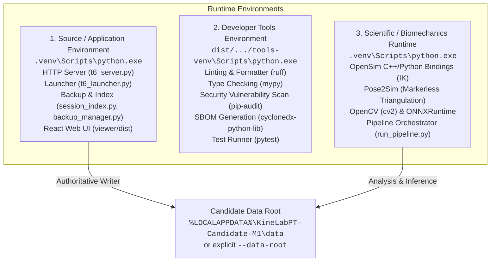

# KineLab PT — Candidate Operations Runbook

**Release Target:** Candidate M1 Local Software Containment  
**Document Revision:** 2026-10-29 R4  
**Classification:** Local Engineering Preview Only — Non-Clinical, Non-Production  

---

## 1. System Overview & Safety Boundary Policy

This runbook defines the operational procedures for installing, configuring, launching, previewing, shutting down, updating, rolling back, and recovering the KineLab PT local software candidate.

### 1.1 Non-Clinical Disclaimer & Scope
> [!CAUTION]
> **NO CLINICAL PERFORMANCE CLAIMS:** KineLab PT is currently an offline research engineering candidate. It has not undergone clinical trials, FDA/CE regulatory clearance, or gold-standard validation against optical motion capture systems (such as Vicon or Qualisys). All angles, joint coordinates, rep counts, and biomechanical summaries are experimental derived values. Missing or unreliable metrics must remain explicitly marked `UNAVAILABLE` rather than defaulting to zero or clinically suggestive estimations.

### 1.2 Mandatory Operational Guardrails
All local operations must strictly adhere to the following safety constraints:
1. **Zero Git Publication:** Never execute `git reset`, `git stash`, `git checkout`, `git commit`, `git push`, `git merge`, `deploy`, or `release`. The working tree contains uncommitted containment checkpoints that must be preserved.
2. **Prohibited Paths:** Never read, modify, link to, or discover data from:
   - `C:\Users\soren\Documents\Projects\KineLab-PT-DualCam` (legacy live application directory)
   - `%LOCALAPPDATA%\KineLabPT` (legacy uncontained user data)
   - The candidate source installation root as a data root
   - The user profile directory root (`%USERPROFILE%` / `Path.home()`)
   - Any NTFS junction, directory symlink, or reparse point (`DATA_ROOT_UNSAFE`).
3. **Destructive Restore Disabled:** In-place restoration over existing sessions is disabled. Calling restore with `overwrite=true` immediately aborts with `HTTP 409 RESTORE_OVERWRITE_UNAVAILABLE`.
4. **Environment Variables:** Always run Python operations with `PYTHONDONTWRITEBYTECODE=1` and `PYTHONUTF8=1` (or pass `.venv\Scripts\python.exe -X utf8 -B`).

---

## 2. Runtime Architecture & Execution Environments

KineLab PT candidate operations strictly separate three runtime environments to prevent dependency leakage and contamination between production services, development tooling, and heavy scientific packages.



### 2.1 Source / Application Runtime
- **Interpreter:** `.venv\Scripts\python.exe`
- **Responsibilities:** Serves authenticated HTTP/WSGI endpoints (`t6_server.py`), manages OS startup locks and token dispatch (`t6_launcher.py`), handles SQLite transactions and append-only audit logging (`session_index.py`), controls chunked recording journals (`recording_store.py`), and serves the compiled React application from `viewer/dist/`.
- **Dependencies:** Python 3.13 standard libraries, SQLite3, and core lightweight dependencies pinned in `requirements.lock.txt`.

### 2.2 Developer Tools Runtime
- **Interpreter:** `dist\fullproject-20261028\tools-venv\Scripts\python.exe`
- **Responsibilities:** Executes code quality checks, static analysis, type checking, security vulnerability audits, and test harnesses without polluting the application's runtime dependencies.
- **Packages:** `ruff` (0.17.3), `mypy` (2.4.1), `pip-audit` (2.10.1), `cyclonedx-python-lib` (11.12.0), `pytest` (9.2.0).

### 2.3 Scientific / Native Processing Runtime
- **Interpreter:** `.venv\Scripts\python.exe` (isolated scientific stack)
- **Responsibilities:** Executes computer vision calibration, markerless triangulation, and musculoskeletal inverse kinematics:
  - `opensim` (v4.5.1+): Biomechanical model fitting and inverse kinematics (`.mot`).
  - `Pose2Sim`: 2D multi-camera triangulation, checkerboard calibration, and temporal filtering (`.trc`).
  - `cv2` (OpenCV): Checkerboard detection and video frame processing.
  - `onnxruntime`: Local neural network pose inference (`pose_inference.py`).
  - `numpy`, `scipy`, `pandas`, `matplotlib`, `reportlab`: Numerical computation and PDF report generation.

---

## 3. Data Roots & Storage Isolation

### 3.1 Default vs. Explicit Data Roots
By default, the candidate runs in a sandboxed, per-user data namespace:
- **Default Data Root:** `%LOCALAPPDATA%\KineLabPT-Candidate-M1\data`
- **Default Runtime State Directory:** `%LOCALAPPDATA%\KineLabPT-Candidate-M1\runtime`

To specify a dedicated custom data root for testing or isolated runs:
- **CLI Parameter:** Pass `--data-root "<absolute-path>"` to `t6_launcher.py` or `t6_server.py`.
- **Environment Variable:** Set `KINELAB_CANDIDATE_DATA_ROOT="<absolute-path>"`.

### 3.2 Directory Validation & Safety Checks (`runtime_config.py`)
Whenever a data root is initialized or resolved, `runtime_config.ensure_data_root()` enforces fail-closed validation:
1. **Absolute Path Required:** Path must be an absolute path with no traversal components (`..`) and cannot be a bare drive anchor (e.g., `C:\`).
2. **Prohibited Paths Refusal:** Raises `ValueError("DATA_ROOT_UNSAFE: application and legacy locations are refused")` if the target is:
   - The application workspace directory (`INSTALLATION`)
   - Legacy data (`%LOCALAPPDATA%\KineLabPT`)
   - Legacy workspace (`C:\Users\soren\Documents\Projects\KineLab-PT-DualCam`)
   - The runtime directory (`%LOCALAPPDATA%\KineLabPT-Candidate-M1\runtime`)
   - The user profile home directory (`Path.home()`)
3. **Reparse & Symlink Refusal:** Raises `ValueError("DATA_ROOT_UNSAFE: linked or reparse directories are refused")` if any component of the path is a symlink or NTFS junction point.
4. **Runtime Identity:** A unique SHA-256 identity is computed from `(installation_path, data_root)`. A running instance refuses to attach or serve requests if the data root identity does not match the active server token.

### 3.3 Test Root Isolation
Automated tests and temporary staging environments must NEVER use persistent user roots. All test cases must instantiate ephemeral directories via `tempfile.mkdtemp(prefix="kinelab-test-")` and clean them up upon completion.

---

## 4. Local Installation & Setup

### 4.1 Prerequisites
- **Operating System:** Windows 10/11 x64 (Build 19045 or later).
- **Python:** Python 3.13 x64 installed locally.
- **Node.js:** Node.js v18+ and npm v9+ (for frontend builds).

### 4.2 Workspace Setup Commands
From PowerShell in the workspace root (`C:\Users\soren\Documents\Projects\KineLab-PT-Production-Agent-Workspace`):

```powershell
# Set required UTF-8 and bytecode suppression flags
$env:PYTHONDONTWRITEBYTECODE = "1"
$env:PYTHONUTF8 = "1"

# 1. Initialize and install Python application virtual environment
python -m venv .venv
.\.venv\Scripts\python.exe -m pip install --upgrade pip
.\.venv\Scripts\python.exe -m pip install -r requirements.lock.txt

# 2. Build the unified React viewer
npm --prefix viewer ci
npm --prefix viewer run build -- --outDir ..\dist\viewer-build --emptyOutDir

# 3. (Optional) Initialize developer tools virtual environment
python -m venv dist\fullproject-20261028\tools-venv
.\dist\fullproject-20261028\tools-venv\Scripts\pip.exe install ruff mypy pip-audit cyclonedx-python-lib pytest
```

---

## 5. Preview & Safe Inspection

Before launching any live server process, operators can safely preview build integrity and verify command-line interfaces.

### 5.1 Safe CLI Inspections (No Side Effects)
Derive all command syntax strictly using `--help`. These commands parse arguments and exit immediately without initializing databases or opening network ports:

```powershell
# Launcher help
.\.venv\Scripts\python.exe -X utf8 -B t6_launcher.py --help

# Local server help
.\.venv\Scripts\python.exe -X utf8 -B t6_server.py --help

# Pipeline and project helpers help
.\.venv\Scripts\python.exe -X utf8 -B setup_project.py --help
.\.venv\Scripts\python.exe -X utf8 -B normalize_capture.py --help
.\.venv\Scripts\python.exe -X utf8 -B export_motion.py --help
```

### 5.2 Frontend Asset Preview
To verify the production frontend build without starting the backend:
1. Verify `viewer/dist/index.html` exists and is non-empty.
2. Verify compiled bundles in `viewer/dist/assets/` (`.js` and `.css`).
3. For cloud-only demo preview, run `npm --prefix viewer run build:cloud`.

---

## 6. Service Startup & Verification

### 6.1 Interactive Desktop Start (Default)
To launch KineLab PT interactively:

```powershell
.\.venv\Scripts\python.exe -X utf8 -B t6_launcher.py
```

**Startup Behavior:**
1. **OS Startup Lock:** Acquires an exclusive lock on `%LOCALAPPDATA%\KineLabPT-Candidate-M1\runtime\t6-startup.lock` using `msvcrt.locking` to serialize startup attempts.
2. **Instance Health Verification:** Checks if an existing instance is already running with the same runtime identity. If healthy, reuses the existing instance.
3. **Port Binding:** Selects an available local port in the range `4184–4203` bound strictly to `127.0.0.1`.
4. **Bearer Token Generation:** Generates a cryptographically strong 32-byte (64 hex character) ephemeral secret token.
5. **State Publication:** Atomically writes the instance descriptor to `%LOCALAPPDATA%\KineLabPT-Candidate-M1\runtime\t6-instance.json` with restricted permissions (0600).
6. **Browser Dispatch:** Opens the default browser to:
   ```
   http://127.0.0.1:<port>/#access=<64-hex-token>
   ```
   *Security Note:* Placing the token in the URL hash fragment prevents it from appearing in HTTP request headers, server access logs, or network proxy traces.
7. **Process Lifecycle:** The launcher holds the server process in the foreground until interrupted.

### 6.2 Starting with an Explicit Data Root
```powershell
.\.venv\Scripts\python.exe -X utf8 -B t6_launcher.py --data-root "C:\Users\soren\CandidateData\test-run-01"
```

### 6.3 Headless Automation Start (No Browser)
For automated testing, scripting, or CI verification where opening a browser window is undesirable:

```powershell
.\.venv\Scripts\python.exe -X utf8 -B t6_launcher.py --no-browser --data-root "C:\Users\soren\CandidateData\test-run-01"
```

**Console Output:**
```
T6_UNIFIED_READY=http://127.0.0.1:4184
T6_NEW_SERVER=True
```

### 6.4 Detached Background Start
```powershell
.\.venv\Scripts\python.exe -X utf8 -B t6_launcher.py --detached --data-root "C:\Users\soren\CandidateData\test-run-01"
```

---

## 7. Service Shutdown & Process Cleanup

### 7.1 Interactive Console Shutdown
If running in the foreground console, press `Ctrl+C`:
1. The launcher catches `KeyboardInterrupt`.
2. Calls `server.shutdown()` and `server.server_close()`.
3. Unlinks the owned `%LOCALAPPDATA%\KineLabPT-Candidate-M1\runtime\t6-instance.json` file.
4. Unbinds the loopback TCP port.

### 7.2 Authenticated HTTP API Shutdown
To programmatically shut down a running server instance without terminating the process abruptly:

```powershell
$token = "<64-hex-token-from-instance-json>"
$port = 4184
$headers = @{ "Authorization" = "Bearer $token"; "Content-Type" = "application/json" }
$body = '{"confirm": true}'

Invoke-RestMethod -Uri "http://127.0.0.1:$port/api/v1/system/shutdown" -Method Post -Headers $headers -Body $body
```

**Response (HTTP 200):**
```json
{
  "status": "shutting_down",
  "message": "KineLab local server is shutting down."
}
```
The server schedules a clean shutdown thread after 300 ms, flushing all open journals and closing SQLite connections.

### 7.3 Crash Recovery & Stale Instance Cleanup
If the application crashes, is killed via Task Manager, or loses power:
1. The next run of `t6_launcher.py` acquires `t6-startup.lock`.
2. Detects that the PID or port in `t6-instance.json` is unresponsive via `/api/v1/health`.
3. Automatically renames the stale state file to `t6-stale-<uuid>.json` for audit retention.
4. Generates a fresh port and token, and starts normally.

---

## 8. Safe Updates & Migrations

### 8.1 Software Update Procedure
Because all session and recording data reside outside the application source tree, updating candidate source code is completely decoupled from data storage:
1. Update application source files or pull verified patches.
2. Recompile frontend assets: `npm --prefix viewer run build`.
3. Run Python unit tests:
   ```powershell
   .\.venv\Scripts\python.exe -X utf8 -B -m unittest discover -s tests -v
   ```
4. Run frontend unit tests:
   ```powershell
   npm --prefix viewer test
   ```

### 8.2 Database Schema Migration (`session_index.py`)
- The session index (`.kinelab_index.db`) uses SQLite WAL mode with versioned migrations (`schema_version = 2`).
- Upon opening, `SessionIndex` verifies table definitions (`sessions`, `sources`, `artifacts`, `audit_log`, `recordings`).
- If schema migrations are required, migrations execute within an atomic transaction.
- Source video files and existing export files are NEVER modified during a migration.

---

## 9. Source-Preserving Uncommitted Checkpoint Rollback

> [!WARNING]
> Under strict teamwork execution boundaries, git history manipulation (`git reset`, `git checkout .`, `git stash`) is strictly prohibited to prevent destroying active uncommitted containment work.

Rollbacks must be performed using file-level cryptographic snapshots.

### 9.1 Checkpoint Structure
Checkpoints are preserved in `dist/fullproject-20261028/`:
- `checkpoint-D-round2-20261029/`: Contains exact copies of application and test files.
- `source-checkpoint.json`: Stores relative file paths, byte sizes, and SHA-256 digests.

### 9.2 File Restoration Procedure
To roll back a file to its verified checkpoint state without using Git:
1. Locate the file in the checkpoint directory:
   `dist\fullproject-20261028\checkpoint-D-round2-20261029\files\<relative-path>`
2. Verify the SHA-256 hash of the checkpoint file matches `source-checkpoint.json`.
3. First copy into a new isolated verification directory and validate its manifest. Preserve a new snapshot of the current working file before considering replacement.
4. Replace a working file only as a separately reviewed rollback with its exact source and destination recorded. Run the affected checks afterward; historical test results do not validate the restored candidate.

---

## 10. Backup & Generation-Isolated Recovery

KineLab PT implements an offline, tamper-evident backup and recovery subsystem (`backup_manager.py`).

### 10.1 Backup Creation
Backups can be triggered via UI or HTTP API:
- **API Endpoint:** `POST /api/v1/backup/create`
- **Request Body:** `{"confirm": true}`
- **Archive Format:** `kinelab.backup.v2` standard `.zip` archive stored in `<data-root>\backups\`.
- **Archive Contents:**
  - `index.db`: Online SQLite backup captured via `sqlite3.Connection.backup()`.
  - `sessions/<session_id>/...`: Complete session folders (metadata, calibration, raw videos, exports).
  - `backup_manifest.json`: JSON manifest listing exact byte counts and SHA-256 hashes of all members, generation UUID, audit tip hash, and schema version.
- **Full Generation Requirement:** Backups must include ALL active sessions. Partial backup selection is refused to prevent orphan foreign key references in the database.

### 10.2 Tamper-Evident Inspection (`inspect_backup`)
Before any extraction or restoration, `BackupManager.inspect_backup()` inspects the archive structure:
- Validates zip compression type (Stored or Deflated only; no encrypted or executable zip members).
- Checks compression ratio (maximum 100:1) to prevent compression bomb attacks.
- Enforces Unicode NFC/NFKC normalized paths; rejects path traversal (`..`), leading slashes, Windows reserved device names (`CON`, `PRN`, `AUX`, `NUL`), and illegal characters.

### 10.3 Generation-Isolated Restore (`restore_generation`)
> [!IMPORTANT]
> **Destructive Overwrite Permanently Disabled:**  
> In-place restoration over existing sessions is disabled. Calling `/api/v1/backup/restore` with `overwrite=true` returns `HTTP 409 RESTORE_OVERWRITE_UNAVAILABLE`. Existing sessions and active databases are strictly immutable.

**Full Generation Recovery Protocol:**
1. When restoring a `kinelab.backup.v2` archive, the system invokes `BackupManager.restore_generation()`.
2. Unpacks files into an isolated temporary directory `.restore-generation-<uuid>` on the same volume.
3. Computes SHA-256 for 100% of extracted files and verifies them against `backup_manifest.json`.
4. Inspects the unpacked `index.db` to verify database generation metadata (`index_schema`, `audit_tip`, `recording_count`).
5. Renames the staging folder atomically into:
   ```
   <data-root>\recovery-generations\recovered-<uuid>\
   ```
6. The active database (`.kinelab_index.db`) and active session folders remain completely untouched (`active_workspace_changed: false`).
7. **Platform Restriction:** Directory publication without in-place replacement is verified for Windows NTFS (`sys.platform == 'win32'`). Other platforms refuse generation restoration until atomic directory publication is verified.

### 10.4 Index Disaster Recovery — BLOCKED

Preserve the failed index, its SQLite sidecars and the session source files unchanged. Stop writes before investigation. An index rebuilt from folders cannot reconstruct the original immutable recording acknowledgments, reference digests or audit history.

The earlier delete-and-reindex procedure is withdrawn. This document authorizes no deletion, replacement, migration or activation of a recovered generation. Recovery must use an independently verified backup, a new isolated generation and inventory checks; selecting that generation requires a separately approved recovery procedure. Existing live data is outside this engineering task.

---

## 11. Package Inventory & Verification

### 11.1 Fresh Desktop Distribution

From the workspace root, create a new output directory and record frontend inputs before building. These commands build a runtime distribution; they do not create a complete source checkpoint or establish clean-machine, physical, or clinical acceptance.

```powershell
$runRoot = Join-Path (Get-Location) ('dist\candidate-package-' + [DateTime]::UtcNow.ToString('yyyyMMddTHHmmssfffZ'))
New-Item -ItemType Directory -Path $runRoot -ErrorAction Stop | Out-Null
.\.venv\Scripts\python.exe -X utf8 -B tools\build_offline_distribution.py --capture-frontend-inputs "$runRoot\frontend-inputs.json"
if ($LASTEXITCODE -ne 0) { throw 'Frontend input capture failed' }
npm --prefix viewer run build -- --outDir "$runRoot\desktop-build-dist" --emptyOutDir
if ($LASTEXITCODE -ne 0) { throw 'Desktop frontend build failed' }
.\.venv\Scripts\python.exe -X utf8 -B tools\build_offline_distribution.py --frontend-inputs "$runRoot\frontend-inputs.json" --frontend-dist "$runRoot\desktop-build-dist" --out "$runRoot\KineLabPT-candidate"
if ($LASTEXITCODE -ne 0) { throw 'Runtime distribution packaging failed' }
```

The staging directory and sibling ZIP must be absent before packaging. The packager rejects linked paths, binds the recorded frontend inputs to the build, records the runtime import closure, and writes `DISTRIBUTION-MANIFEST.json`.

### 11.2 Package Hash & Inventory Verification

The packaging command verifies the staging inventory and hashes before creating and checking its ZIP. Preserve its output, manifest, archive hash, and source evidence. `tools/verify_evidence.py` instead requires an explicit `.kinelab.zip` or backup archive argument; it is not a verifier for this runtime distribution.

### 11.3 Local Quality Gate Checks

The runner plans checks unless `--run` is supplied. Use its actual check IDs as separate arguments and preserve the new receipts and logs. This selection covers scientific runtime, backend tests, full-tree lint/type policy, dependencies, advisories, and workflow parsing; frontend tests and fresh cloud/desktop builds remain separate checks.

```powershell
$qualityRoot = Join-Path (Get-Location) ('dist\candidate-quality-' + [DateTime]::UtcNow.ToString('yyyyMMddTHHmmssfffZ'))
New-Item -ItemType Directory -Path $qualityRoot -ErrorAction Stop | Out-Null
.\.venv\Scripts\python.exe -X utf8 -B tools\check_quality.py --run `
  --python .\.venv\Scripts\python.exe `
  --tools-python .\dist\fullproject-20261028\tools-venv\Scripts\python.exe `
  --checks python-runtime python-syntax python-dependencies python-tests node-runtime node-dependencies lint typecheck typecheck-harness security-advisories npm-advisories workflow-syntax `
  --receipts-dir "$qualityRoot\receipts" --out "$qualityRoot\quality.json"
if ($LASTEXITCODE -ne 0) { throw 'Quality checks did not pass; inspect preserved receipts' }
```

Verify both Python environments and the selected tools before execution. A saved plan, missing prerequisite, skipped check, or historical log is not a fresh passing result.

---

## 12. Honest Assessment of Missing External Gates

To prevent false confidence or premature clinical deployment, the following gates are explicitly declared UNVERIFIED and BLOCKING:

| Gate | Current Status | Required Validation to Close |
|---|---|---|
| **Clean-Machine VM Installation** | **UNVERIFIED** | Must execute distribution installer on a pristine Windows 10/11 VM without Python, Git, Node, or visual C++ runtimes pre-installed. |
| **Native Redistributable Bundling** | **UNVERIFIED** | OpenSim, Pose2Sim, FFmpeg, and Python runtime are currently external. Offline portable deployment requires signed, self-contained bundling. |
| **Dual-Camera Hardware Synchronization** | **UNVERIFIED** | Real dual-camera video capture with sub-millisecond physical synchronization (cues, audio clap, or genlock) remains uncollected. |
| **Clinical Gold-Standard Benchmark** | **UNVERIFIED** | No comparative trial against optical motion capture (Vicon/Qualisys) for lower-extremity kinematics (knee flexion/extension angles). |
| **Human Subject Data Privacy** | **BLOCKED** | Institutional IRB/ethics approval, informed consent workflow, and certified de-identification protocols (D04, D08) are open. |
| **Physical EMG Muscle Activity** | **BLOCKED** | Measured muscle activity is not implemented. Digital twin avatar visualization is derived and non-measured (D03). |
| **Owner Release Acceptance** | **NOT GRANTED** | Formal owner acceptance for clinical release or commercial distribution has not been granted. |
